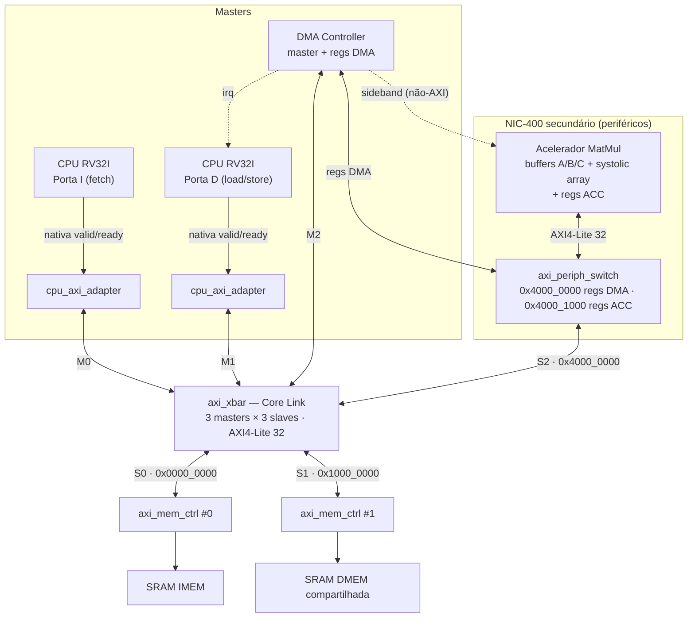

# RV32I + DMA + Systolic Array

Implementação em Verilog de um processador RISC-V RV32I com coprocessador de multiplicação matricial e controlador DMA baseado em systolic array, desenvolvido no Programa CI Digital da CEPEDI.

> **Status:** 🚧 Entrega 1 em andamento (prazo: 01/11/2026)

## Equipe

| Nome | GitHub | Responsabilidade |
|------|--------|------------------|
| _Nome_ | @usuario | _CPU / DMA / Acelerador / Verificação_ |
| _Nome_ | @usuario | _..._ |

## Visão geral

O sistema calcula **C = A × B**. A CPU apenas configura os endereços e dimensões das matrizes e dispara a operação; o DMA move os dados e alimenta o systolic array sem intervenção da CPU. O fim da operação é sinalizado por registrador de status e, preferencialmente, interrupção.

- Processador RISC-V RV32I em RTL
- Interface de controle mapeada em memória
- Controlador DMA com FSM própria (leitura de A/B, escrita de C)
- Systolic array de MACs parametrizável (`ARRAY_SIZE`), com tiling para matrizes maiores que a malha
- Memória de dados compartilhada entre CPU e DMA/acelerador

## Estrutura do repositório

```
.
├── docs/          # Especificação, diagramas, mapa de memória
│   ├── spec/      # Enunciado do projeto
│   └── img/       # Imagens usadas na documentação
├── rtl/
│   ├── cpu/       # RISC-V RV32I
│   ├── dma/       # Controlador DMA
│   ├── accel/     # MAC e malha sistólica
│   └── top/       # Top-level e memória compartilhada
├── model/         # Golden model (C/C++/Python) com tiling
├── sw/            # Firmware (C/Assembly RISC-V)
├── tb/
│   ├── unit_accel/  # Testbench unitário do acelerador
│   ├── unit_dma/    # Testbench DMA + memória + acelerador
│   └── uvm/         # Ambiente UVM integrado
├── scripts/       # Makefiles e scripts de simulação
└── synth/         # Scripts, logs e reports de síntese
```

---

# 📦 Entrega 1 — Planejamento, Microarquitetura e Modelo de Referência

**Prazo:** 01/11/2026 (Semana 4)

Objetivo: garantir que o grupo entendeu o escopo e definiu como os módulos se comunicam **antes** de escrever o RTL.

## Checklist

- [ ] **Repositório GitHub**: criação, estrutura de diretórios e primeiro commit
- [ ] **Especificação** (este README ou PDF em `docs/`)
  - [x] Diagrama de blocos detalhado do top-level
  - [ ] Mapa de memória (matrizes e registradores do DMA/acelerador)
  - [ ] Especificação dos sinais de interface CPU ↔ DMA ↔ Acelerador
- [ ] **Modelo de referência (golden model)** em C, C++ ou Python com multiplicação matricial por blocos (tiling)

---

## 1. Diagrama de blocos (top-level)

Arquivo editável (draw.io): [`docs/img/top_level.drawio`](docs/img/top_level.drawio) — gerado por [`scripts/gen_drawio.py`](scripts/gen_drawio.py). A arquitetura segue o padrão do diagrama de referência ARM CoreLink NIC-400: masters → adapters → switch central → switch secundário aninhado → controladores de memória → memórias, com todos os links em **AMBA AXI4-Lite, 32 bits**.



### Correspondência com a figura de referência

| Figura NIC-400 | Nosso bloco |
|----------------|-------------|
| Cortex-A (AXI4) ×2 | CPU RV32I — Porta I (fetch) e Porta D (load/store), 2 masters AXI4-Lite |
| L2C-310 ×2 | `cpu_axi_adapter` ×2 (interface nativa valid/ready → AXI4-Lite) |
| DMA | DMA Controller (master AXI4-Lite) |
| Core Link NIC-400 switch | `axi_xbar` (3 masters × 3 slaves) |
| NIC-400 switch secundário | `axi_periph_switch` (regs DMA / regs ACC) |
| Mali GPU / Interface block / Video | Acelerador MatMul (slave de registradores + sideband com o DMA) |
| DMC-400 ×2 | `axi_mem_ctrl` ×2 (IMEM, DMEM) |
| PHY + DDR3/2 LPDDR2 ×2 | SRAM IMEM e SRAM DMEM compartilhada |

### Blocos

| Bloco | Função |
|-------|--------|
| CPU RV32I | Core multiciclo; Porta I só lê instruções, Porta D executa load/store. Apenas configura e dispara o DMA. |
| `cpu_axi_adapter` | Converte a interface nativa valid/ready da CPU em AXI4-Lite. |
| `axi_xbar` (interconexão / decodificador) | Decodifica `addr[31:28]`, arbitra os masters (round-robin) e roteia para IMEM, DMEM ou periféricos. |
| `axi_periph_switch` | Decodifica `addr[15:12]` entre regs DMA (`0x4000_0000`) e regs ACC (`0x4000_1000`). |
| `axi_mem_ctrl` | Slave AXI4-Lite que acessa a SRAM (suporta `WSTRB`). |
| Memória de instruções | SRAM do firmware (`0x0000_0000`), carregada por `$readmemh`. |
| Memória de dados compartilhada | SRAM (`0x1000_0000`) com as matrizes A, B e C, acessada por CPU e DMA. |
| DMA | Master AXI4-Lite com FSM própria: lê A/B, alimenta o acelerador, lê C e a escreve na DMEM; sinaliza `done` e `irq`. |
| Buffers locais (A, B, C) | Memórias internas do acelerador, escritas/lidas pelo DMA via sideband. |
| Systolic array | Malha `ARRAY_SIZE×ARRAY_SIZE` de MACs (parâmetro de elaboração). |

## 2. Decisões de microarquitetura

| Item | Decisão | Justificativa |
|------|---------|---------------|
| Pipeline da CPU | Multiciclo, duas portas (I e D) | Menor risco de implementação; espelha os 2 masters da figura de referência e evita arbitrar fetch × dados dentro da CPU |
| Barramento CPU ↔ periféricos | AMBA AXI4-Lite, 32 bits, single-beat (sem ID/burst), 1 transação outstanding por master | Padrão pedido para o projeto; o DMA move uma palavra por transação (menor throughput, FSM e xbar mais simples) |
| Largura dos operandos | _ex.: 8 bits com sinal_ | _..._ |
| Largura do acumulador | _ex.: 32 bits_ | _evita overflow para N máximo_ |
| `ARRAY_SIZE` | 2, 4 e 8 | Parâmetro RTL só do acelerador; demais blocos independentes dele |
| Fluxo de dados do array | _ex.: output-stationary_ | _..._ |
| Estratégia de tiling | _..._ | _..._ |
| Sinalização de término | _status + IRQ_ | _..._ |

## 3. Mapa de memória

### 3.1 Mapa global

| Região | Endereço base | Tamanho | Descrição |
|--------|---------------|---------|-----------|
| Memória de instruções | `0x0000_0000` | _..._ | Firmware |
| Memória de dados | `0x1000_0000` | _..._ | Dados + matrizes A, B, C |
| Registradores DMA/Acelerador | `0x4000_0000` | _..._ | Controle mapeado em memória |

> Valores acima são sugestões — ajustar conforme o projeto.

### 3.2 Registradores do DMA / acelerador

| Offset | Nome | Acesso | Descrição |
|--------|------|--------|-----------|
| `0x00` | `CTRL` | R/W | `start`, `irq_en`, `reset` |
| `0x04` | `STATUS` | R | `busy`, `done`, `error` |
| `0x08` | `ADDR_A` | R/W | Endereço-base da matriz A |
| `0x0C` | `ADDR_B` | R/W | Endereço-base da matriz B |
| `0x10` | `ADDR_C` | R/W | Endereço-base da matriz C |
| `0x14` | `DIM_M` | R/W | Linhas de A / C |
| `0x18` | `DIM_N` | R/W | Colunas de B / C |
| `0x1C` | `DIM_K` | R/W | Colunas de A / linhas de B |

### 3.3 Layout das matrizes na memória

> TODO: row-major? alinhamento? tamanho de cada elemento?

## 4. Interfaces entre módulos

### 4.1 CPU ↔ memória / periféricos

| Sinal | Dir. | Largura | Descrição |
|-------|------|---------|-----------|
| `addr` | out | 32 | _..._ |
| `wdata` | out | 32 | _..._ |
| `rdata` | in | 32 | _..._ |
| `we` | out | 1 | _..._ |
| `valid` / `ready` | out / in | 1 | _..._ |

### 4.2 DMA ↔ memória compartilhada

| Sinal | Dir. | Largura | Descrição |
|-------|------|---------|-----------|
| _..._ | | | |

### 4.3 DMA ↔ acelerador

| Sinal | Dir. | Largura | Descrição |
|-------|------|---------|-----------|
| `req` | DMA→ACC | 1 | _..._ |
| `ready` / `busy` | ACC→DMA | 1 | _..._ |
| `done` | ACC→DMA | 1 | _..._ |
| `data_a`, `data_b` | DMA→ACC | _..._ | _..._ |
| `data_c` | ACC→DMA | _..._ | _..._ |

### 4.4 Interrupção

| Sinal | Dir. | Descrição |
|-------|------|-----------|
| `irq` | DMA→CPU | _..._ |

## 5. Máquina de estados do DMA (rascunho)

> TODO: diagrama de estados (ex.: `IDLE → READ_A → READ_B → COMPUTE → WRITE_C → DONE`) e descrição das transições.

## 6. Modelo de referência (golden model)

- **Linguagem:** _C / C++ / Python_
- **Local:** [`model/`](model/)
- **Funcionalidade:** multiplicação matricial por blocos (tiling) com `ARRAY_SIZE` configurável
- **Como executar:**

```bash
# TODO
```

- **Formato de saída:** _ex.: arquivos .hex/.txt de A, B e C esperado, reaproveitáveis no testbench_

### Casos de teste previstos

| Caso | M × K × N | Observação |
|------|-----------|------------|
| 1 | 2×2×2 | Cabe na malha |
| 2 | 4×4×4 | _..._ |
| 3 | 6×5×7 | Requer tiling / não múltiplo |
| 4 | _..._ | Valores extremos (negativos, máximos) |

## 7. Plano de trabalho

| Entrega | Prazo | Conteúdo | Responsável | Status |
|---------|-------|----------|-------------|--------|
| 1 | 01/11/2026 | Planejamento, microarquitetura e golden model | | ⏳ |
| 2 | 14/11/2026 | RTL do MAC/systolic array + testbench unitário (2×2 e 4×4) | | ⬜ |
| 3 | 22/11/2026 | RTL do DMA e memória compartilhada + testbench integrado sem CPU | | ⬜ |
| 4 | 13/12/2026 | Top-level, firmware e UVM integrado | | ⬜ |
| Final | 18–19/12/2026 | Relatório técnico, síntese (≥ 3 configurações) e apresentação | | ⬜ |

## 8. Riscos e dúvidas em aberto

- _..._

---

## Roadmap das próximas entregas

- **Entrega 2:** MAC + malha sistólica parametrizável, testbench unitário para ≥ 2 tamanhos
- **Entrega 3:** FSMs do DMA, memória compartilhada, testbench atuando como CPU (BFM)
- **Entrega 4:** top-level com RV32I, firmware C/Assembly, ambiente UVM com comparação automática contra o golden model
- **Entrega final:** relatórios de síntese (área, timing, recursos) de ≥ 3 configurações, relatório técnico em PDF, slides e demo de waveform

## Referências

- [Enunciado do projeto](docs/spec/enunciado.pdf)
- The RISC-V Instruction Set Manual, Volume I: Unprivileged ISA
- [PicoRV32](https://github.com/YosysHQ/picorv32) — core RV32I simples, referência de CPU e de interface de memória valid/ready
