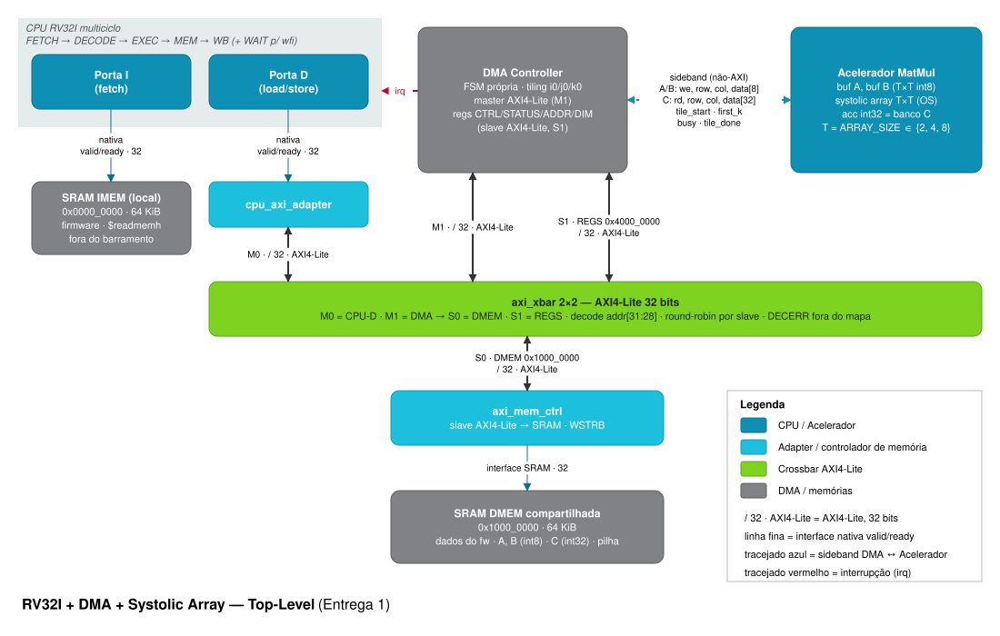
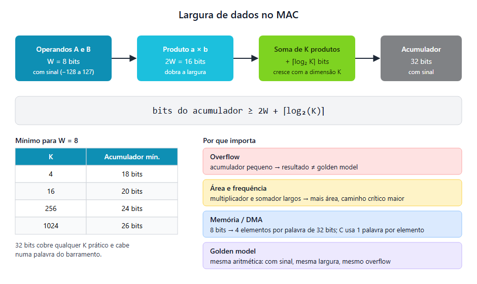
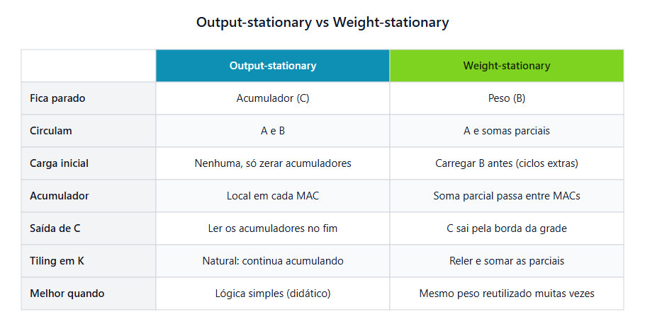
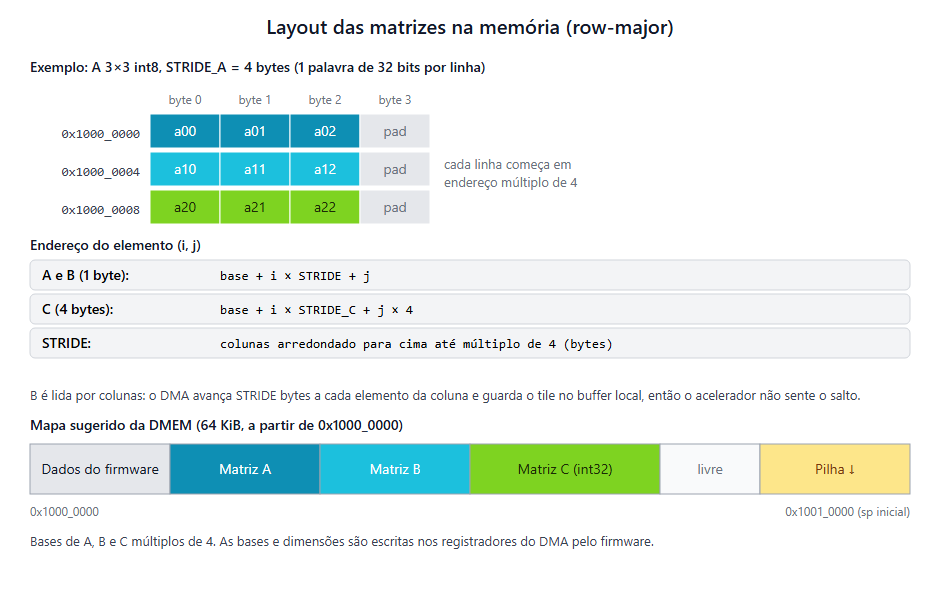
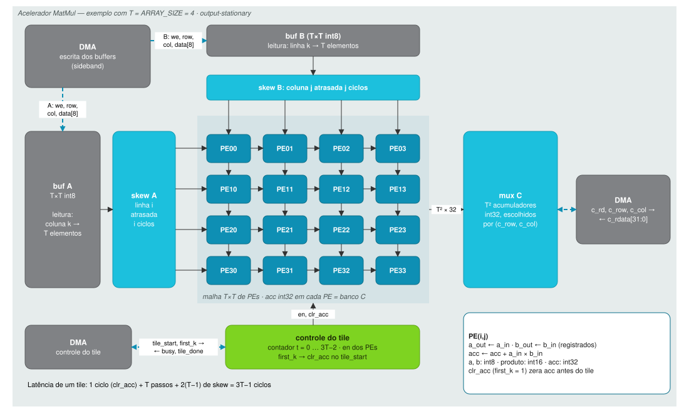
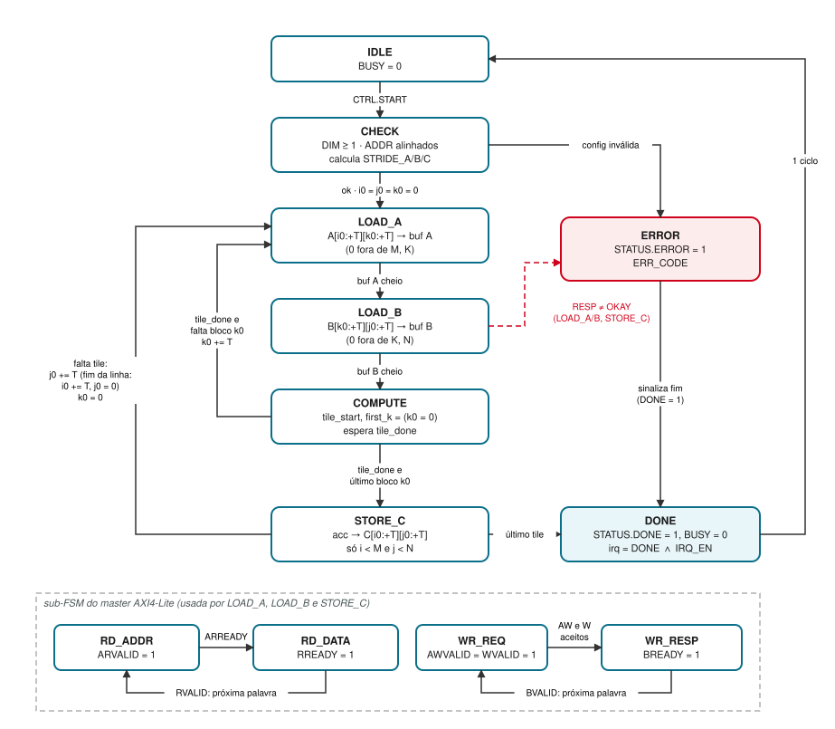
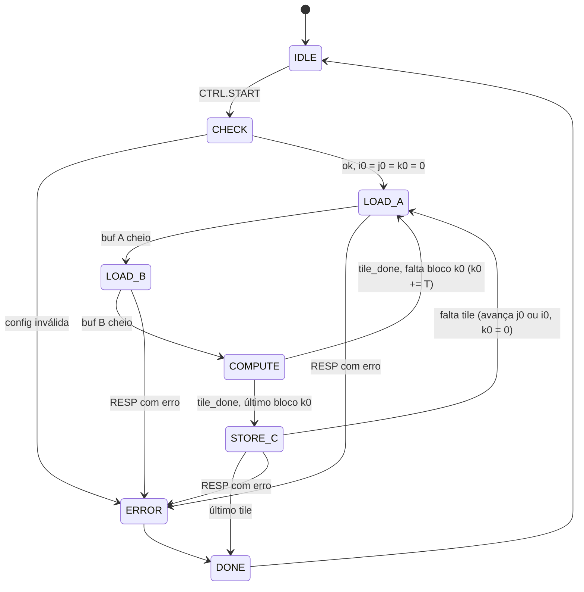
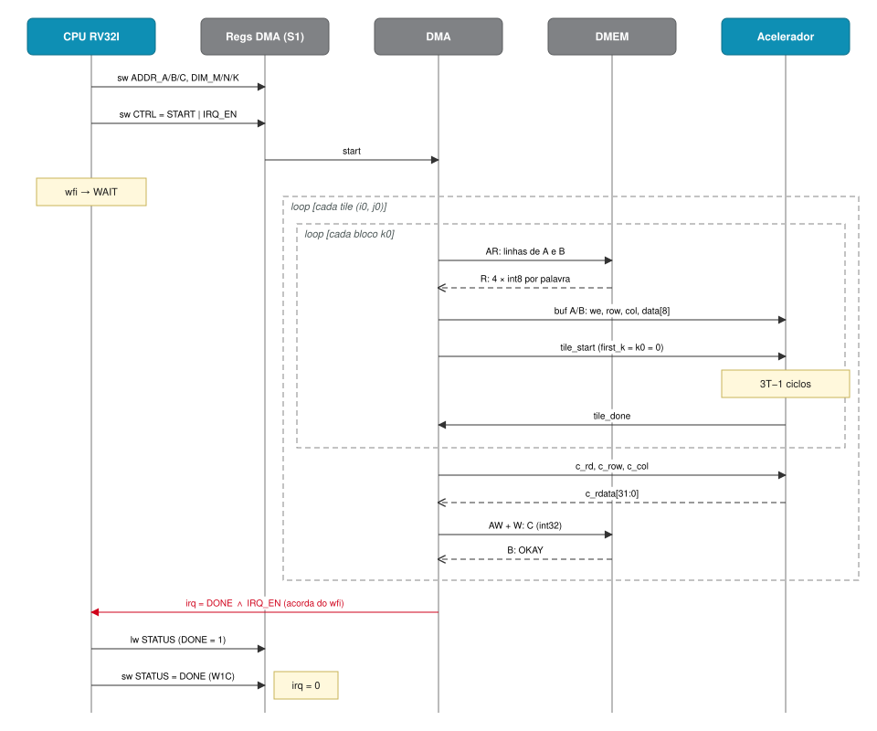
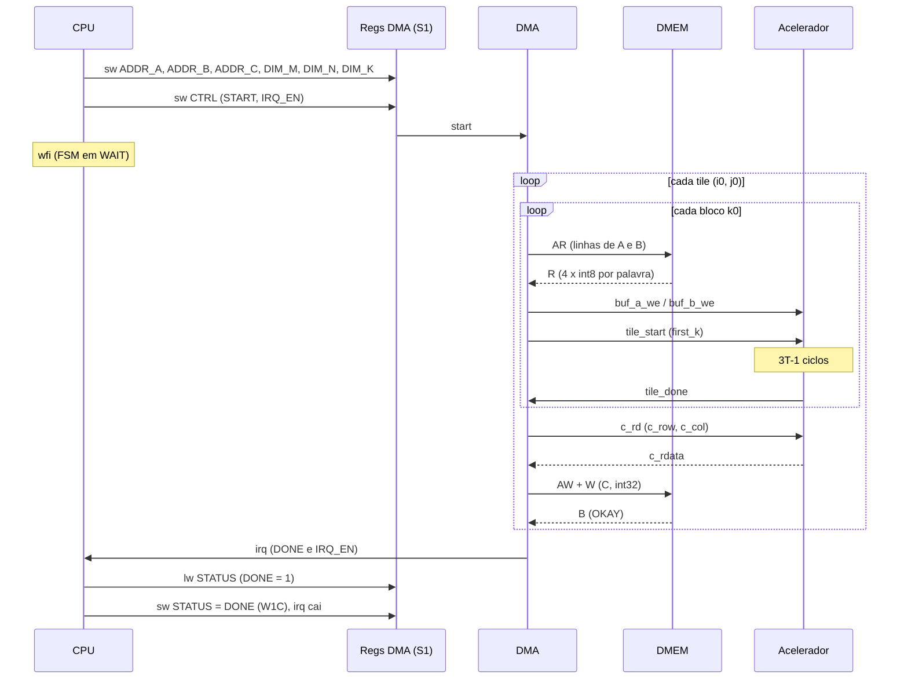

# RV32I + DMA + Systolic Array

Implementação em Verilog de um processador RISC-V RV32I com coprocessador de multiplicação matricial e controlador DMA baseado em systolic array, desenvolvido no Programa CI Digital da CEPEDI.

> **Status:** ✅ Entregas 1 e 2 concluídas (próxima etapa: Entrega 3 — DMA e Memória Compartilhada)

## Equipe

| Nome | GitHub | Responsabilidade |
|------|--------|------------------|
| _Nome_ | @usuario | _CPU / DMA / Acelerador / Verificação_ |
| _Nome_ | @usuario | _..._ |

## Visão geral

O sistema calcula **C = A × B**. A CPU apenas configura os endereços e dimensões das matrizes e dispara a operação; o DMA move os dados e alimenta o systolic array sem intervenção da CPU. O fim da operação é sinalizado por registrador de status e por interrupção, que acorda a CPU de um `wfi`.

- Processador RISC-V RV32I multiciclo em RTL, com portas de instrução e de dados separadas
- Barramento AMBA AXI4-Lite (32 bits) com crossbar 2×2 entre CPU, DMA, memória de dados e registradores
- Interface de controle mapeada em memória (registradores do DMA em `0x4000_0000`)
- Controlador DMA com FSM própria (leitura de A/B em tiles, escrita de C)
- Systolic array output-stationary de MACs parametrizável (`ARRAY_SIZE`), com tiling para matrizes maiores que a malha
- Memória de dados compartilhada entre CPU e DMA/acelerador

## Estrutura do repositório

```
.
├── docs/          # Especificação, diagramas, mapa de memória
│   ├── spec/      # Enunciado do projeto e especificações AXI / RISC-V
│   └── img/       # Diagramas (.drawio + .svg) e figuras de decisões
├── rtl/
│   ├── cpu/       # RISC-V RV32I
│   ├── dma/       # Controlador DMA
│   ├── accel/     # MAC e malha sistólica
│   └── top/       # Top-level e memória compartilhada
├── model/         # Golden model (C/C++/Python) com tiling
├── sw/            # Firmware (C/Assembly RISC-V)
├── tb/
│   ├── unit_accel/  # Testbench unitário do acelerador
│   ├── unit_dma/    # Testbench DMA + memória + acelerador
│   └── uvm/         # Ambiente UVM integrado
├── scripts/       # Geração de diagramas, Makefiles e scripts de simulação
└── synth/         # Scripts, logs e reports de síntese
```

---

# 📦 Entrega 1 — Planejamento, Microarquitetura e Modelo de Referência

**Prazo:** 01/11/2026 (Semana 4)

Objetivo: garantir que o grupo entendeu o escopo e definiu como os módulos se comunicam **antes** de escrever o RTL.

## Checklist

### Entrega 1 — Planejamento, Microarquitetura e Modelo de Referência
- [x] **Repositório GitHub**: criação, estrutura de diretórios e primeiro commit
- [x] **Especificação** (este README)
  - [x] Diagrama de blocos detalhado do top-level (§1)
  - [x] Mapa de memória: matrizes e registradores do DMA/acelerador (§3)
  - [x] Especificação dos sinais de interface CPU ↔ DMA ↔ Acelerador (§4)
- [x] **Modelo de referência (golden model)** em Python com multiplicação matricial por blocos (tiling) e exportação .hex (§8)

### Entrega 2 — RTL do Acelerador (Systolic Array) e Testes Unitários
- [x] **Código RTL do Acelerador**:
  - [x] Unidade MAC / PE ([`rtl/accel/pe.v`](rtl/accel/pe.v)): operandos int8, acumulador int32, output-stationary
  - [x] Malha sistólica parametrizável ([`rtl/accel/accel.v`](rtl/accel/accel.v)): buffers locais de A e B, registradores de skew, FSM com latência 3T-1 ciclos
- [x] **Testbench Unitário**:
  - [x] Simulação com autocheck ([`tb/unit_accel/tb_accel.v`](tb/unit_accel/tb_accel.v)) simulando injeção de dados pelo DMA
  - [x] Validação comprovada para malhas 2×2 (com múltiplos blocos de K) e 4×4

---

## 1. Diagrama de blocos (top-level)



Fonte editável (draw.io): [`docs/img/top_level.drawio`](docs/img/top_level.drawio). Todos os diagramas deste documento são gerados por [`scripts/gen_drawio.py`](scripts/gen_drawio.py), que escreve o `.drawio` e o `.svg` de cada um a partir do mesmo modelo ([`scripts/diagram_lib.py`](scripts/diagram_lib.py)):

```bash
python3 scripts/gen_drawio.py
```

A topologia segue a ideia do diagrama de referência ARM CoreLink NIC-400 (masters → adapter → crossbar → controlador de memória → memória), reduzida ao que o sistema precisa: só a porta de dados da CPU e o DMA disputam o barramento. Uma alternativa sem AXI, só com handshake valid/ready, foi avaliada em [`docs/img/top_level_handshake.drawio`](docs/img/top_level_handshake.drawio) e descartada (ver §2).

### Correspondência com a figura de referência

| Figura NIC-400 | Nosso bloco |
|----------------|-------------|
| Cortex-A (AXI4) ×2 | CPU RV32I: a Porta D é master AXI4-Lite (M0); a Porta I busca na IMEM local, fora do barramento |
| L2C-310 ×2 | `cpu_axi_adapter` ×1 (Porta D: valid/ready → AXI4-Lite) |
| DMA | DMA Controller: master AXI4-Lite (M1) + bloco de registradores (slave S1) |
| Core Link NIC-400 switch | `axi_xbar` 2 masters × 2 slaves |
| NIC-400 switch secundário | — (removido: o acelerador não fica no barramento) |
| Mali GPU / Interface block / Video | Acelerador MatMul (só sideband com o DMA) |
| DMC-400 ×2 | `axi_mem_ctrl` ×1 (DMEM) |
| PHY + DDR3/2 LPDDR2 ×2 | SRAM DMEM compartilhada; SRAM IMEM local da CPU |

### Blocos

| Bloco | Função |
|-------|--------|
| CPU RV32I | Core multiciclo (FETCH → DECODE → EXEC → MEM → WB, + WAIT para `wfi`). A Porta I busca instruções na IMEM local; a Porta D faz load/store pelo barramento. Só configura e dispara o DMA. |
| Memória de instruções | SRAM de 64 KiB em `0x0000_0000`, lida só pela Porta I, carregada por `$readmemh`. |
| `cpu_axi_adapter` | Converte a Porta D (valid/ready) em master AXI4-Lite: leitura → AR/R, escrita → AW/W/B. `WSTRB` vem de `d_wstrb`. |
| `axi_xbar` | 2 masters × 2 slaves. Decodifica `addr[31:28]` (`0x1` → S0, `0x4` → S1, demais → DECERR), arbitra cada slave em round-robin e liga o caminho até a resposta (1 transação por master). |
| `axi_mem_ctrl` | Slave AXI4-Lite que acessa a SRAM síncrona, respeitando `WSTRB`. |
| Memória de dados compartilhada | SRAM de 64 KiB em `0x1000_0000` com dados do firmware, matrizes A, B, C e pilha; acessada pela CPU e pelo DMA. |
| DMA | Master AXI4-Lite (M1) com FSM própria de tiling + bloco de registradores (slave S1). Lê A/B, preenche os buffers, dispara o tile, lê C e a escreve na DMEM; sinaliza `DONE` e `irq`. |
| Acelerador | buf A e buf B (T×T int8), registradores de skew e malha T×T de PEs output-stationary; os acumuladores int32 servem de banco C. Controlado só pelo DMA, via sideband. |

## 2. Decisões de microarquitetura

| Item | Decisão | Alternativas descartadas | Justificativa |
|------|---------|--------------------------|---------------|
| Microarquitetura da CPU | Multiciclo: FSM FETCH → DECODE → EXEC → MEM → WB (+ WAIT) | Single-cycle (RTL inicial); PicoRV32 | Uma interface valid/ready com latência variável encaixa naturalmente numa FSM (cada estado espera seu `ready`); a single-cycle precisaria de stall em todo acesso; o PicoRV32 é core de terceiros e o enunciado pede a CPU em RTL |
| Portas da CPU | Duas portas valid/ready: I (fetch) direto na IMEM local; D (load/store) no barramento | Porta I também no xbar (3 masters × 3 slaves) | Fetch sem arbitragem e sem latência AXI (CPI ~4–5); a CPU nunca disputa a DMEM com o DMA para buscar instrução; a mesma interface nas duas portas permite levar a I para o AXI depois |
| Barramento | AMBA AXI4-Lite, 32 bits, single-beat (sem ID/burst), 1 transação em andamento por master | Handshake valid/ready simples; NIC-400 completo (xbar 3×3 + switch secundário) | AXI4-Lite é o padrão do projeto; o DMA vira um master real disputando a DMEM com a CPU; o switch secundário só existia para registradores do acelerador, que não são necessários |
| Interconexão | `axi_xbar` 2×2: M0 = CPU-D, M1 = DMA; S0 = DMEM, S1 = registradores; round-robin por slave; DECERR fora do mapa | — | Menor crossbar que atende o sistema: menos árbitros e decodificadores para verificar |
| Controle do acelerador | Só pelo DMA, via sideband; a CPU vê um único bloco de registradores (no DMA) | Registradores próprios do acelerador no barramento | No fluxo exigido a CPU nunca fala direto com o acelerador; elimina um slave AXI |
| Largura dos operandos | int8 com sinal (−128 … 127), 4 por palavra | int16; int8 com 1 elemento por palavra | MAC 8×8 ocupa ~¼ da área de um 16×16 → mais PEs pela mesma área; empacotar 4 por palavra reduz em 4× as transações AXI de A e B |
| Largura do acumulador | int32 com sinal | 16/20/24 bits; 40 bits | Precisa de 2W + ⌈log₂ K⌉ bits: 32 bits cobre K ≤ 65536 sem overflow (§2.1); C cabe em uma palavra do barramento |
| `ARRAY_SIZE` (T) | 2, 4 e 8 (parâmetro de elaboração) | — | Três configurações exigidas na síntese; só o acelerador e as larguras de índice do sideband dependem de T |
| Fluxo de dados do array | Output-stationary: C fica no acumulador de cada PE; A flui → e B flui ↓, com skew | Weight-stationary | Acumula todos os blocos de K dentro do PE (tiling em K sem somar parciais fora da malha); controle mais simples (§2.2) |
| Estratégia de tiling | Tiles T×T×T; laço i0 → j0 → k0 (k0 por dentro); buffers A/B de T×T; `first_k` zera os acumuladores; zero-padding nas bordas | Ping-pong (double buffering); painéis T×K_MAX | Buffers mínimos que escalam com T; K arbitrário; dimensões não múltiplas de T (ex.: 6×5×7) sem lógica especial |
| Sinalização de término | `STATUS.DONE` (W1C) + `irq = DONE ∧ IRQ_EN`; o firmware usa `wfi` | Polling puro; trap completo (Zicsr: `mtvec`, `mepc`, `mret`) | Usa a interrupção de fato com um estado a mais na FSM da CPU e sem CSRs; polling continua possível com `IRQ_EN = 0` |

### 2.1 Largura dos dados



Cada produto int8 × int8 ocupa 16 bits com sinal; somar K produtos acrescenta ⌈log₂ K⌉ bits. O acumulador precisa de pelo menos **2W + ⌈log₂ K⌉** bits (W = 8):

| K | 4 | 16 | 256 | 1024 | 65536 |
|---|---|----|-----|------|-------|
| Bits necessários | 18 | 20 | 24 | 26 | 32 |

Com 32 bits não há overflow para K ≤ 65536 (`DIM_K` tem 16 bits, logo K ≤ 65535). Hardware e golden model usam a mesma aritmética em complemento de 2 com 32 bits, então os resultados coincidem bit a bit.

### 2.2 Fluxo de dados: output-stationary × weight-stationary



No output-stationary cada PE acumula um elemento de C durante todos os blocos k0 do tile: basta não zerar o acumulador entre blocos (`first_k = 0`). No weight-stationary, B precisaria ser pré-carregado a cada tile e as somas parciais de K teriam de ser acumuladas fora da malha.

## 3. Mapa de memória

### 3.1 Mapa global

| Região | Base | Fim | Tamanho | Acesso | Descrição |
|--------|------|-----|---------|--------|-----------|
| Memória de instruções (IMEM) | `0x0000_0000` | `0x0000_FFFF` | 64 KiB | só Porta I (fetch) | Firmware (`.text`) |
| Memória de dados (DMEM) | `0x1000_0000` | `0x1000_FFFF` | 64 KiB | CPU (Porta D) e DMA, via S0 | `.data`/`.rodata`/`.bss`, matrizes A, B, C e pilha |
| Registradores DMA/Acelerador | `0x4000_0000` | `0x4000_0FFF` | 4 KiB | CPU (Porta D), via S1 | Controle mapeado em memória (§3.2) |
| Demais endereços | — | — | — | — | Resposta `DECERR` (`RESP = 0b11`) |

O `axi_xbar` decodifica `addr[31:28]`; dentro de cada região, o slave usa só os bits baixos (`addr[15:2]` na DMEM, `addr[11:2]` nos registradores).

Mapa sugerido da DMEM:

| Endereço | Conteúdo |
|----------|----------|
| `0x1000_0000` | Dados do firmware (`.data`, `.rodata`, `.bss`) |
| `0x1000_1000` (ADDR_A sugerido) | A: M × STRIDE_A bytes (int8) |
| `0x1000_4000` (ADDR_B sugerido) | B: K × STRIDE_B bytes (int8) |
| `0x1000_8000` (ADDR_C sugerido) | C: M × 4N bytes (int32) |
| … | Livre |
| `0x1001_0000` | Topo da pilha (`sp` inicial; cresce para baixo) |

ADDR_A/B/C são programados pelo firmware: basta serem múltiplos de 4 e as matrizes não se sobreporem. Os valores sugeridos comportam A até 12 KiB, B até 16 KiB e C até ~28 KiB (deixando 4 KiB para a pilha).

### 3.2 Registradores do DMA / acelerador

Base `0x4000_0000`. Todos os registradores têm 32 bits e são acessados com `lw`/`sw`.

| Offset | Nome | Acesso | Reset | Campos |
|--------|------|--------|-------|--------|
| `0x00` | `CTRL` | R/W | `0` | `[0] START` (escrever 1 dispara; lê 0) · `[1] IRQ_EN` · `[2] SOFT_RESET` (escrever 1 leva o DMA a IDLE e limpa `STATUS`; lê 0) |
| `0x04` | `STATUS` | R / W1C | `0` | `[0] BUSY` (RO) · `[1] DONE` (W1C) · `[2] ERROR` (W1C) · `[7:4] ERR_CODE` (RO: 1 = dimensão zero, 2 = endereço desalinhado, 3 = resposta `SLVERR`/`DECERR`) |
| `0x08` | `ADDR_A` | R/W | `0` | Endereço-base de A (`[1:0]` = 0) |
| `0x0C` | `ADDR_B` | R/W | `0` | Endereço-base de B (`[1:0]` = 0) |
| `0x10` | `ADDR_C` | R/W | `0` | Endereço-base de C (`[1:0]` = 0) |
| `0x14` | `DIM_M` | R/W | `0` | `[15:0]` M: linhas de A e de C (1 … 65535) |
| `0x18` | `DIM_N` | R/W | `0` | `[15:0]` N: colunas de B e de C |
| `0x1C` | `DIM_K` | R/W | `0` | `[15:0]` K: colunas de A e linhas de B |
| `0x20` | `CYCLES` | RO | `0` | Ciclos de clock de `START` até `DONE` (zera no `START`); usado na comparação entre configurações |
| `0x24` | `INFO` | RO | — | `[7:0] ARRAY_SIZE` · `[15:8]` largura do operando (8) · `[23:16]` largura do acumulador (32) · `[31:24]` versão |

Regras:

- `irq = STATUS.DONE ∧ CTRL.IRQ_EN` (nível). Cai quando o firmware escreve 1 em `STATUS.DONE`.
- Com `BUSY = 1`, escritas em `ADDR_*`, `DIM_*` e um novo `START` são ignoradas.
- Offsets não mapeados leem 0 e ignoram escrita (resposta `OKAY`).
- Erro de configuração (dimensão zero ou endereço desalinhado) ou resposta de erro no barramento → `ERROR = 1`, `ERR_CODE` e `DONE = 1`.

### 3.3 Layout das matrizes na memória



- **Ordem:** row-major para A, B e C.
- **A e B:** int8 empacotados, 4 elementos por palavra, little-endian (o elemento de menor coluna fica nos bits `[7:0]`). Cada linha começa em endereço múltiplo de 4; os bytes de padding no fim da linha são ignorados.
- **C:** int32, 1 elemento por palavra.
- **Strides**, calculados pelo DMA a partir de `DIM_*` (o firmware não programa):
  - `STRIDE_A = ⌈K/4⌉ · 4` bytes
  - `STRIDE_B = ⌈N/4⌉ · 4` bytes
  - `STRIDE_C = 4 · N` bytes
- **Endereços:**
  - `end(A[i][k]) = ADDR_A + i · STRIDE_A + k`
  - `end(B[k][j]) = ADDR_B + k · STRIDE_B + j`
  - `end(C[i][j]) = ADDR_C + i · STRIDE_C + 4j`
- **Extração do byte:** `elem = sext8(palavra >> (8 · end[1:0]))`.

> Com tiles T×T×T, o DMA lê **A e B sempre por linhas**: cada linha de tile é contígua na memória e ocupa ⌈T/4⌉ palavras (T e k0/j0 múltiplos de T mantêm o tile dentro de palavras alinhadas). A reordenação para "coluna k de A" e "linha k de B" acontece na leitura dos buffers. Por isso a busca de B por colunas mostrada na figura não é necessária.

## 4. Interfaces entre módulos

Notação: T = `ARRAY_SIZE`, `IW = max(1, $clog2(T))`. Direções do ponto de vista do primeiro bloco citado.

### 4.1 CPU ↔ memórias (portas nativas valid/ready)

Mesma convenção nas duas portas, no estilo do PicoRV32: a CPU sobe `valid` com endereço/dados estáveis e os mantém até `ready = 1` (pulso de 1 ciclo, com `rdata` válido no mesmo ciclo). Há no máximo uma requisição em andamento por porta.

**Porta I (fetch) → IMEM local**

| Sinal | Dir. | Largura | Descrição |
|-------|------|---------|-----------|
| `i_valid` | out | 1 | Requisição de busca |
| `i_addr` | out | 32 | PC (alinhado a 4) |
| `i_ready` | in | 1 | Instrução disponível em `i_rdata` |
| `i_rdata` | in | 32 | Instrução |

**Porta D (load/store) → `cpu_axi_adapter`**

| Sinal | Dir. | Largura | Descrição |
|-------|------|---------|-----------|
| `d_valid` | out | 1 | Requisição de load/store |
| `d_addr` | out | 32 | Endereço do byte |
| `d_wstrb` | out | 4 | `0000` = leitura; escrita: SB `0001 << addr[1:0]`, SH `0011 << addr[1:0]`, SW `1111` |
| `d_wdata` | out | 32 | Dado de escrita, já posicionado na lane do byte |
| `d_ready` | in | 1 | Transação concluída |
| `d_rdata` | in | 32 | Palavra lida (a CPU extrai e estende byte/half) |

Outras entradas da CPU: `clk`, `rst_n` e `irq` (§4.4). Erros de barramento (`SLVERR`/`DECERR`) não geram trap: a leitura retorna 0 e a escrita é descartada.

### 4.2 AXI4-Lite (xbar, adapter, DMA, controlador de memória)

Interfaces: **M0** (`cpu_axi_adapter` → xbar), **M1** (DMA → xbar), **S0** (xbar → `axi_mem_ctrl`), **S1** (xbar → registradores do DMA). Direções do ponto de vista do master.

| Canal | Sinal | Dir. | Largura | Descrição |
|-------|-------|------|---------|-----------|
| Global | `ACLK`, `ARESETn` | in | 1 | Clock e reset ativo em 0 |
| AW | `AWADDR` | out | 32 | Endereço de escrita |
| AW | `AWPROT` | out | 3 | Fixo `3'b000` |
| AW | `AWVALID` / `AWREADY` | out / in | 1 | Handshake do endereço |
| W | `WDATA` | out | 32 | Dado de escrita |
| W | `WSTRB` | out | 4 | Byte enables |
| W | `WVALID` / `WREADY` | out / in | 1 | Handshake do dado |
| B | `BRESP` | in | 2 | `OKAY` = 00, `SLVERR` = 10, `DECERR` = 11 |
| B | `BVALID` / `BREADY` | in / out | 1 | Handshake da resposta |
| AR | `ARADDR` | out | 32 | Endereço de leitura |
| AR | `ARPROT` | out | 3 | Fixo `3'b000` |
| AR | `ARVALID` / `ARREADY` | out / in | 1 | Handshake do endereço |
| R | `RDATA` | in | 32 | Dado lido |
| R | `RRESP` | in | 2 | Como `BRESP` |
| R | `RVALID` / `RREADY` | in / out | 1 | Handshake do dado |

Regras adotadas:

- Um `VALID` nunca depende do `READY` correspondente e, uma vez em 1, fica estável até o handshake.
- Cada master tem no máximo **uma transação em andamento** (leitura ou escrita). AW e W são emitidos juntos e podem ser aceitos em ciclos diferentes.
- O xbar arbitra cada slave em round-robin e mantém o caminho master ↔ slave até R ou B. Endereços fora do mapa recebem `DECERR` de um slave padrão interno.

### 4.3 DMA ↔ acelerador (sideband, não-AXI)

| Sinal | Dir. | Largura | Descrição | Papel no enunciado |
|-------|------|---------|-----------|--------------------|
| `buf_a_we` | DMA→ACC | 1 | Escreve `buf_wdata` em buf A[`buf_row`][`buf_col`] | Transferência de A |
| `buf_b_we` | DMA→ACC | 1 | Escreve `buf_wdata` em buf B[`buf_row`][`buf_col`] | Transferência de B |
| `buf_row`, `buf_col` | DMA→ACC | IW | Posição no buffer | |
| `buf_wdata` | DMA→ACC | 8 | Elemento int8 (0 fora da matriz = zero-padding) | |
| `tile_start` | DMA→ACC | 1 | Pulso: inicia o processamento do tile com os buffers atuais | **Requisição** |
| `first_k` | DMA→ACC | 1 | Amostrado com `tile_start`: 1 = zera os acumuladores antes (primeiro bloco k0) | |
| `busy` | ACC→DMA | 1 | 1 enquanto a malha processa | **Pronto/ocupado** |
| `tile_done` | ACC→DMA | 1 | Pulso ao fim do processamento (acumuladores estáveis) | **Conclusão** |
| `c_rd` | DMA→ACC | 1 | Lê o acumulador (`c_row`, `c_col`) | Transferência de C |
| `c_row`, `c_col` | DMA→ACC | IW | Posição do elemento de C no tile | |
| `c_rdata` | ACC→DMA | 32 | Valor int32, válido no ciclo seguinte a `c_rd` | |

Regras: o DMA só escreve nos buffers e lê C com `busy = 0`; o acelerador ignora `tile_start` com `busy = 1`.

### 4.4 Interrupção

| Sinal | Dir. | Descrição |
|-------|------|-----------|
| `irq` | DMA→CPU | Nível: `STATUS.DONE ∧ CTRL.IRQ_EN`. Acorda a CPU do estado WAIT (`wfi`); cai quando o firmware escreve 1 em `STATUS.DONE`. Se `irq` já estiver em 1 quando o `wfi` executa, a CPU não para, então o evento nunca se perde. |

## 5. Acelerador (microarquitetura)



Fonte editável: [`docs/img/accel.drawio`](docs/img/accel.drawio).

- **Buffers:** buf A e buf B guardam T×T elementos int8 cada, escritos pelo DMA pelo sideband (§4.3).
- **Streaming:** no passo t (0 … T−1), a linha i da malha recebe A[i][t] atrasado i ciclos e a coluna j recebe B[t][j] atrasado j ciclos (registradores de skew). Fora da janela entram zeros, que não alteram os acumuladores.
- **PE:** `acc ← acc + a·b`; repassa `a` para a direita e `b` para baixo por registradores. O PE(i,j) recebe o par de índice k no ciclo k + i + j.
- **Latência por tile:** 1 ciclo inicial (`clr_acc` zera os acumuladores se `first_k = 1`) + T passos + 2(T−1) de skew = **3T − 1 ciclos**; então `tile_done`.
- **Leitura de C:** mux T²:1 sobre os acumuladores, endereçado por (`c_row`, `c_col`).
- **O que escala com T:** T² MACs (multiplicador 8×8 + somador 32 bits), 2T² bytes de buffer, T² acumuladores de 32 bits e o mux de C. O caminho crítico do PE (multiplicador + somador) não depende de T; o mux de C cresce com log T.
- **Ciclos de cálculo** para M×N×K: ⌈M/T⌉ · ⌈N/T⌉ · ⌈K/T⌉ tiles de 3T − 1 ciclos. O restante da latência é do DMA (2T² bytes por bloco k0 e T² palavras de C por tile) e é medido no registrador `CYCLES`.

### Como simular o testbench unitário do acelerador

```bash
iverilog -g2012 -o sim_accel.vvp tb/unit_accel/tb_accel.v rtl/accel/pe.v rtl/accel/accel.v
vvp sim_accel.vvp
```

## 6. Máquina de estados do DMA



Fonte editável: [`docs/img/dma_fsm.drawio`](docs/img/dma_fsm.drawio).



| Estado | O que faz | Próximo estado |
|--------|-----------|----------------|
| `IDLE` | `BUSY = 0`; espera `CTRL.START` | `CHECK` |
| `CHECK` | Valida `DIM_* ≥ 1` e `ADDR_*` alinhados; calcula `STRIDE_A/B/C`; zera i0, j0, k0 e `CYCLES` | `LOAD_A` · `ERROR` |
| `LOAD_A` | Para r = 0 … T−1: lê as ⌈T/4⌉ palavras de A[i0+r][k0 … k0+T−1], extrai os bytes e escreve em buf A[r][c]. Escreve 0 sem ler a memória quando i0+r ≥ M ou k0+c ≥ K | `LOAD_B` · `ERROR` |
| `LOAD_B` | Igual para B[k0+r][j0 … j0+T−1] → buf B; 0 quando k0+r ≥ K ou j0+c ≥ N | `COMPUTE` · `ERROR` |
| `COMPUTE` | Pulso de `tile_start` com `first_k = (k0 == 0)`; espera `tile_done` | `LOAD_A` (k0 += T, se k0 + T < K) · `STORE_C` |
| `STORE_C` | Para cada (r, c) com i0+r < M e j0+c < N: `c_rd` e escrita de C[i0+r][j0+c] (AW + W, espera B). Fora disso não escreve (máscara de borda) | `LOAD_A` (próximo tile: j0 += T; se j0 ≥ N, j0 = 0 e i0 += T; k0 = 0) · `DONE` (i0 ≥ M) · `ERROR` |
| `ERROR` | `STATUS.ERROR = 1`, grava `ERR_CODE` | `DONE` |
| `DONE` | `STATUS.DONE = 1`, `BUSY = 0`, congela `CYCLES`; `irq` sobe se `IRQ_EN = 1` | `IDLE` |

`LOAD_A`, `LOAD_B` e `STORE_C` usam a sub-FSM do master AXI4-Lite. Leitura: `RD_ADDR` (`ARVALID`) → `RD_DATA` (`RREADY`) → próxima palavra. Escrita: `WR_REQ` (`AWVALID` e `WVALID`) → `WR_RESP` (`BREADY`) → próxima palavra.

## 7. Sequência de uma operação completa



Fonte editável: [`docs/img/sequencia.drawio`](docs/img/sequencia.drawio).



Firmware mínimo (C, em [`sw/`](sw/)):

```c
#include <stdint.h>

#define DMA_BASE      0x40000000u
#define REG(off)      (*(volatile uint32_t *)(DMA_BASE + (off)))
#define CTRL          0x00
#define STATUS        0x04
#define ADDR_A        0x08
#define ADDR_B        0x0C
#define ADDR_C        0x10
#define DIM_M         0x14
#define DIM_N         0x18
#define DIM_K         0x1C

#define CTRL_START    (1u << 0)
#define CTRL_IRQ_EN   (1u << 1)
#define STATUS_DONE   (1u << 1)
#define STATUS_ERROR  (1u << 2)

int main(void) {
    REG(ADDR_A) = 0x10001000u;
    REG(ADDR_B) = 0x10004000u;
    REG(ADDR_C) = 0x10008000u;
    REG(DIM_M)  = 6;
    REG(DIM_N)  = 7;
    REG(DIM_K)  = 5;
    REG(CTRL)   = CTRL_START | CTRL_IRQ_EN;

    while (!(REG(STATUS) & STATUS_DONE))
        __asm__ volatile ("wfi");             // CPU fica em WAIT até irq = 1

    uint32_t st = REG(STATUS);
    REG(STATUS) = STATUS_DONE | STATUS_ERROR; // W1C: irq volta a 0
    return (st & STATUS_ERROR) ? 1 : 0;
}
```

## 8. Modelo de referência (golden model)

- **Linguagem:** Python 3 (proposta), sem dependências externas
- **Local:** [`model/`](model/)
- **Funcionalidade:**
  - Gera A (M×K) e B (K×N) int8, aleatórios com semente ou de casos fixos.
  - Calcula C com o mesmo laço de tiles do hardware (i0 → j0 → k0, T = `ARRAY_SIZE`), acumulando em int32 com wrap em complemento de 2.
  - Confere o resultado contra a multiplicação direta (três laços). Em aritmética inteira o resultado não depende da ordem, então os dois precisam coincidir.
- **Saídas:**
  - `dmem.hex`: imagem da DMEM com A e B no layout da §3.3, para `$readmemh`.
  - `c_expected.hex`: C esperado, uma palavra int32 por linha.
  - Os dois arquivos são reaproveitados no testbench e no UVM.
- **Como executar:**

```bash
# Execução padrão com dimensões customizadas:
python model/golden.py --m 6 --k 5 --n 7 --t 4 --seed 1

# Execução de um caso de teste pré-definido (ex.: caso 3):
python model/golden.py --case 3

# Validação automática de todos os casos e parametrizações (autocheck):
python model/golden.py --test-all
```

### Casos de teste previstos

| Caso | M × K × N | Observação |
|------|-----------|------------|
| 1 | 2×2×2 | Cabe na malha para T ≥ 2 |
| 2 | 4×4×4 | 1 tile com T = 4; 2×2×2 tiles com T = 2; tile parcial com T = 8 (zero-padding) |
| 3 | 6×5×7 | Não múltiplo de T: bordas com zero-padding e máscara de escrita de C |
| 4 | 8×8×8 | Valores extremos (−128 e 127): maior produto em módulo |
| 5 | 1×1×1 | Dimensão mínima |
| 6 | 3×64×3 | K longo: muitos blocos k0 acumulando (`first_k` só no primeiro) |

## 9. Plano de trabalho

| Entrega | Prazo | Conteúdo | Responsável | Status |
|---|---|---|---|:---:|
| 1 | 01/11/2026 | Planejamento, microarquitetura e golden model | | ✅ |
| 2 | 14/11/2026 | RTL do MAC/systolic array + testbench unitário (2×2 e 4×4) | | ✅ |
| 3 | 22/11/2026 | RTL do DMA e memória compartilhada + testbench integrado sem CPU | | ⏳ |
| 4 | 13/12/2026 | Top-level, firmware e UVM integrado | | ⬜ |
| Final | 18–19/12/2026 | Relatório técnico, síntese (≥ 3 configurações) e apresentação | | ⬜ |

## 10. Riscos e dúvidas em aberto

- **CPU:** o RTL atual em [`rtl/cpu/`](rtl/cpu/) é single-cycle, com IMEM/DMEM internas e só LW/SW. Para ser RV32I completo e seguir esta especificação, precisa de:
  - FSM multiciclo com as portas I/D valid/ready;
  - estado WAIT para o `wfi`;
  - LB/LH/LBU/LHU/SB/SH, via `d_wstrb`.
- **Síntese:** memórias de 64 KiB em flip-flops dominariam a área e esconderiam a diferença entre as configurações. Proposta: sintetizar o acelerador (e o DMA) para T = 2, 4 e 8, com as SRAMs como modelos comportamentais fora da síntese. A ferramenta de síntese ainda não foi definida.
- **AXI4-Lite:** violações de handshake (`VALID` dependente de `READY`, `VALID` caindo antes do handshake) travam o xbar. Mitigação: assertions nos testbenches unitários.
- **Desempenho:** com AXI4-Lite single-beat e uma transação por vez, o DMA domina a latência. A comparação de ciclos entre as configurações deve mostrar isso. Buffers ping-pong ficam como melhoria futura.
- **Firmware:** a Porta D não enxerga a IMEM. Por isso `.rodata` e `.data` precisam ser ligados na DMEM (linker script) e pré-carregados por `$readmemh`.
- **Dúvidas para o professor:**
  - O `wfi` acordado pelo `irq` atende o "preferencialmente interrupção"?
  - A síntese pode excluir as memórias?

---

## Roadmap das próximas entregas

- **Entrega 2:** MAC + malha sistólica parametrizável, testbench unitário para ≥ 2 tamanhos
- **Entrega 3:** FSMs do DMA, memória compartilhada, testbench atuando como CPU (BFM)
- **Entrega 4:** top-level com RV32I, firmware C/Assembly, ambiente UVM com comparação automática contra o golden model
- **Entrega final:** relatórios de síntese (área, timing, recursos) de ≥ 3 configurações, relatório técnico em PDF, slides e demo de waveform

## Referências

- [Enunciado do projeto](docs/spec/enunciado.pdf)
- The RISC-V Instruction Set Manual, Volume I: Unprivileged ISA ([`docs/spec/riscv-unprivileged.pdf`](docs/spec/riscv-unprivileged.pdf))
- AMBA AXI and ACE Protocol Specification, Arm IHI 0022E ([`docs/spec/IHI0022E_amba_axi_and_ace_protocol_spec_4.pdf`](docs/spec/IHI0022E_amba_axi_and_ace_protocol_spec_4.pdf)) e Introduction to AMBA AXI4, Arm 102202 ([`docs/spec/102202_0100_01_Introduction_to_AMBA_AXI.pdf`](docs/spec/102202_0100_01_Introduction_to_AMBA_AXI.pdf))
- [Guia didático AMBA AXI4](docs/spec/Guia_AMBA_AXI4.docx)
- [PicoRV32](https://github.com/YosysHQ/picorv32) — core RV32I simples, referência de CPU e de interface de memória valid/ready
