# MAS — Controlador DMA com AXI4 burst e prefetch (ping-pong)

**Micro-Architecture Specification** do DMA do projeto RV32I + DMA + Systolic Array.

| Campo | Valor |
|---|---|
| Documento | `docs/dma_mas.md` |
| Versão | 1.1 (rascunho para revisão da equipe) |
| Data | 11/11/2026 |
| Responsável pelo DMA | Luiz Augusto dos Santos Oliveira ([@guto7191](https://github.com/guto7191)) |
| Interconexão AXI | João Vítor Cedraz Carneiro ([@JvCedrazC](https://github.com/JvCedrazC)) |
| Status | Em revisão. Nada aqui está implementado em RTL ainda |
| Substitui | README §2 (linha "Barramento"), §4.2, §4.3 e §6, que descreviam a versão AXI4-Lite sem prefetch |

### Histórico

| Versão | Data | Mudança |
|---|---|---|
| 1.0 | 11/11/2026 | Primeira versão: sistema em AXI4 com burst INCR, prefetch com bancos ping-pong, parâmetro `PINGPONG` |
| 1.1 | 11/11/2026 | Revisão da auditoria: motores com fila de 1 comando; dreno que para na linha e só termina com as FSMs paradas; reset dos bancos no `CHECK`; `last_blk` no lugar de `n_blocks`; `c_release` com tempo definido; `acc_busy`/`acc_active`; `ADDR_*[1:0]` armazenados; fórmula do ping-pong com gargalo de escrita; forma de onda de escrita corrigida |

### Como ler este documento

- **Implementação:** as seções 5 a 13 são normativas. Onde aparece "deve", é requisito do RTL.
- **Ordem de construção:** a seção 17 é o roteiro passo a passo. Cada passo diz o que construir, de que depende e como saber que terminou.
- **Justificativa do prefetch:** a seção 7 explica por que o ping-pong existe e quanto ele rende.
- **Convenções:**
  - `T` = `ARRAY_SIZE` (2, 4 ou 8).
  - `IW = max(1, ⌈log₂T⌉)`: largura de índice de linha/coluna do tile.
  - `WPR = ⌈T/4⌉`: palavras de 32 bits por linha de tile de A/B (4 int8 por palavra).
  - `WW = max(1, ⌈log₂WPR⌉)`: largura do índice de palavra.
  - Sinais ativos em 1, exceto `rst_n`/`ARESETn`. Endereços em bytes. "Ciclo" = borda de subida de `clk`.

---

## 1. Introdução

### 1.1 Objetivo

O DMA move as matrizes A e B da DMEM para os buffers locais do acelerador, dispara o cálculo de cada tile na malha sistólica e grava C de volta na DMEM. A CPU só programa os registradores e espera a interrupção (enunciado §1, §3 e §5).

Esta versão muda duas coisas em relação ao README:

1. **Barramento AXI4 com burst** no sistema inteiro, em vez de AXI4-Lite single-beat. Cada linha de tile vira **um** burst, em vez de uma transação por palavra.
2. **Prefetch com bancos ping-pong** no acelerador. O DMA carrega o próximo bloco e grava o tile anterior enquanto a malha calcula. Um parâmetro `PINGPONG` liga e desliga isso, para que o ganho seja medido e não só estimado.

### 1.2 Escopo

**Dentro do escopo:**
- RTL do DMA (`rtl/dma/`).
- Mudanças na interface e nos buffers do acelerador (`rtl/accel/accel.v`).
- Microarquitetura da interconexão AXI4: `axi_xbar`, slave padrão de erro, `axi_mem_ctrl` e `cpu_axi_adapter`.
- Perfil AXI4 do projeto, plano de verificação e plano de construção.

**Fora do escopo:**
- RTL interno da CPU (só a interface da Porta D importa aqui).
- Firmware.
- Ambiente UVM integrado (Entrega 4). A seção 16 lista o que o UVM vai reaproveitar.

### 1.3 Glossário

| Termo | Significado |
|---|---|
| Beat | Uma transferência de dados de 32 bits num canal R ou W (um handshake `VALID ∧ READY`) |
| Burst | Transação AXI com `AxLEN + 1` beats e endereço incrementando 4 bytes por beat (INCR) |
| Outstanding | Transação cujo endereço já foi aceito e cuja resposta (último R ou B) ainda não chegou |
| Tile | Bloco T×T de C, identificado pelo canto (i0, j0) |
| Bloco k0 | Fatia T×T de A (linhas i0…, colunas k0…) e de B (linhas k0…, colunas j0…) que contribui para um tile |
| Banco | Uma cópia de buf A + buf B no acelerador. Com `PINGPONG=1` há 2 bancos (0 e 1) |
| Banco C | Registradores de saída T×T int32 no acelerador, para onde os acumuladores são copiados no fim de um tile |
| Prefetch | Carregar o próximo bloco num banco livre enquanto a malha usa o outro |
| L | Latência de leitura: ciclos do `ARVALID` até o primeiro beat de R aceito |

### 1.4 Referências

| Documento | Uso |
|---|---|
| [`docs/spec/enunciado.pdf`](spec/enunciado.pdf) §3, §5, §6, §7, §11 | Requisitos do DMA e critérios de avaliação |
| [`docs/spec/IHI0022E_amba_axi_and_ace_protocol_spec_4.pdf`](spec/IHI0022E_amba_axi_and_ace_protocol_spec_4.pdf) | Cap. A3 (handshake, dependências entre canais, bursts, regra dos 4 KB), A5 (IDs e ordenação), A8 (sinais adicionais: QoS e REGION) |
| [`docs/spec/102202_0100_01_Introduction_to_AMBA_AXI.pdf`](spec/102202_0100_01_Introduction_to_AMBA_AXI.pdf), [`Guia_AMBA_AXI4.docx`](spec/Guia_AMBA_AXI4.docx) | Introdução didática ao AXI4 |
| [`README.md`](../README.md) §3 (mapa de memória e layout), §5 (acelerador), §8 (golden model e casos de teste) | Partes da especificação que este MAS mantém |
| [`rtl/accel/accel.v`](../rtl/accel/accel.v), [`model/golden.py`](../model/golden.py) | Acelerador atual (Entrega 2) e modelo de referência |
| [`docs/spec/DMA.pdf`](spec/DMA.pdf) | Contexto: artigo sobre um controlador DMA multicanal com FIFO em MPSoC. Não é normativo; a arquitetura deste MAS é própria |

---

## 2. Requisitos rastreáveis

Cada requisito aponta para a seção que o atende e para o teste que o comprova (seção 16).

| ID | Requisito | Origem | Seção | Teste |
|---|---|---|---|---|
| REQ-DMA-01 | Transferir blocos de A e B da memória principal para os buffers locais do acelerador | Enunciado §5 | 8, 10 | TB-RD, TB-DMA |
| REQ-DMA-02 | Transferir os resultados do acelerador para a matriz C na memória | Enunciado §5 | 8, 10 | TB-WR, TB-DMA |
| REQ-DMA-03 | Operar sem a CPU após a configuração; a CPU não move elementos | Enunciado §3, §5 | 8, 9 | TB-DMA (BFM só escreve registradores) |
| REQ-DMA-04 | Registradores de endereço-base, dimensões, controle e status | Enunciado §5 | 6 | TB-REGS |
| REQ-DMA-05 | Coordenação com o acelerador por requisição, pronto/ocupado e conclusão | Enunciado §5 | 11 | TB-ACC, TB-DMA |
| REQ-DMA-06 | Lógica de controle própria para leitura e escrita em memória | Enunciado §3 | 9, 10 | TB-RD, TB-WR |
| REQ-DMA-07 | Fim sinalizado por registrador de status e por interrupção | Enunciado §2 | 6 | TB-REGS, TB-DMA |
| REQ-DMA-08 | Matrizes maiores que a malha via tiling, incluindo dimensões não múltiplas de T | Enunciado §4 | 8, 10 | TB-DMA casos 3 e 6 |
| REQ-DMA-09 | Resultado idêntico ao golden model | Enunciado §3, §7 | 16 | TB-DMA (comparação com `c_expected.hex`) |
| REQ-DMA-10 | Funcionar para T = 2, 4 e 8 | Enunciado §4, §6 | 5, 15 | Regressão T × casos |
| REQ-DMA-11 | Medir ciclos da multiplicação (`CYCLES`) | Enunciado §6 | 6, 14 | TB-DMA |
| REQ-AXI-01 | Masters e slaves seguem o perfil AXI4 da seção 4 (bursts INCR, 4 KB, handshake) | Decisão do grupo | 4, 12 | Checker AXI em todos os TBs |
| REQ-AXI-02 | Resposta de erro (`SLVERR`/`DECERR`) não trava o sistema e é reportada em `STATUS` | Decisão do grupo | 13 | TB-DMA injeção de erro |
| REQ-PP-01 | `PINGPONG=1`: carga, cálculo e gravação sobrepostos; `PINGPONG=0`: operação serial | Decisão do grupo | 7, 9, 11 | TB-DMA nos dois modos, comparação de `CYCLES` |

---

## 3. Visão do sistema

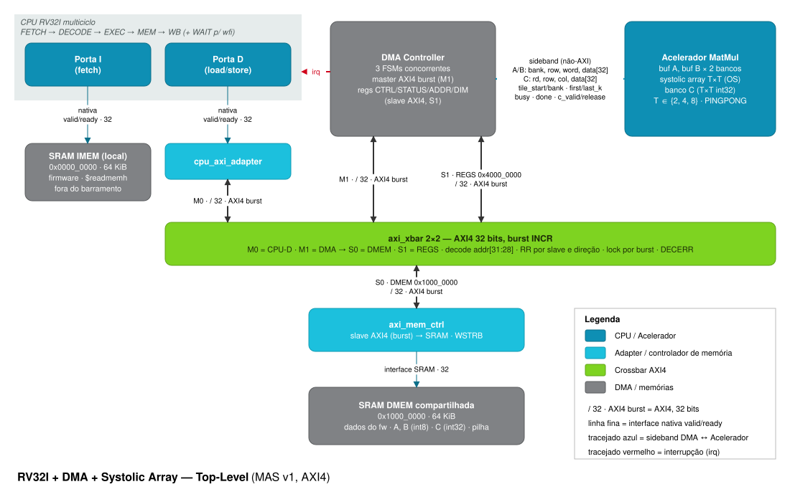

Fonte editável: [`img/top_level.drawio`](img/top_level.drawio).

### 3.1 O que muda em relação à Entrega 1

A coluna do meio descreve a especificação da Entrega 1 (README em `main`). O README desta branch já foi atualizado e aponta para este MAS.

| Item | Entrega 1 (`main`) | Este MAS |
|---|---|---|
| Protocolo | AXI4-Lite, single-beat, sem ID | AXI4, bursts INCR até 16 beats, ID |
| Master DMA (M1) | 1 palavra por transação, leitura e escrita alternadas | 1 burst por linha de tile; 1 leitura e 1 escrita em andamento ao mesmo tempo |
| Porta de escrita dos buffers | 1 int8 por ciclo (`buf_wdata[7:0]`, `buf_col`) | 1 palavra (4 int8) por ciclo (`buf_wdata[31:0]`, `buf_word`) |
| Buffers do acelerador | 1 buf A + 1 buf B | `PINGPONG=1`: 2 bancos de A/B + banco C. `PINGPONG=0`: como antes |
| FSM do DMA | Uma FSM linear LOAD_A → LOAD_B → COMPUTE → STORE_C | Controle + 3 FSMs concorrentes (load, compute, store) + 2 motores AXI |
| `ERR_CODE` | 3 = erro de barramento | 3 = erro de leitura, 4 = erro de escrita |
| `INFO` | `[31:24]` versão | `[27:24]` versão = 2, `[28]` `PINGPONG` |
| Registrador novo | — | `CYC_COMPUTE` (0x28): ciclos com a malha ocupada |

### 3.2 O que não muda

- **Mapa de memória global (README §3.1):** IMEM `0x0000_0000`, DMEM `0x1000_0000`, registradores `0x4000_0000`, DECERR no resto.
- **Layout das matrizes (README §3.3):**
  - Ordem row-major.
  - A e B: int8 empacotados, little-endian, cada linha começando em endereço múltiplo de 4.
  - C: int32, 1 elemento por palavra.
  - Strides: `STRIDE_A = ⌈K/4⌉·4`, `STRIDE_B = ⌈N/4⌉·4`, `STRIDE_C = 4N`.
- **Ordem dos tiles:** i0 → j0 → k0, com k0 no laço mais interno. Por isso `model/golden.py` continua válido sem mudanças.
- **Aritmética:** int8 × int8 com acumulação int32 em complemento de 2 (README §2.1).
- **Topologia:** a IMEM fica fora do barramento e a CPU só configura o DMA.

---

## 4. Perfil AXI4 do projeto

O AXI4 tem muitas opções. Este perfil fixa o subconjunto que **todos** os masters e slaves do projeto usam. Qualquer coisa fora dele é proibida no master e, no slave, recebe a resposta definida na tabela 4.3.

### 4.1 Parâmetros

| Parâmetro | Valor | Observação |
|---|---|---|
| `ADDR_W` | 32 | |
| `DATA_W` | 32 | `WSTRB` tem 4 bits |
| `ID_W` (lado master) | 1 | Todo master usa ID = 0 |
| `S_ID_W` (lado slave) | 2 | O xbar acrescenta o índice do master no bit mais alto: `{m_idx, id}` |
| `MAX_BURST` | 16 | `AxLEN ≤ 15`. O maior burst real é 8 beats (linha de C com T = 8) |

### 4.2 Sinais e valores

Direções do ponto de vista do master. "Fixo" é o único valor permitido no perfil.

| Canal | Sinal | Largura | Valor / regra |
|---|---|---|---|
| Global | `ACLK`, `ARESETn` | 1 | Clock único; reset assíncrono ativo em 0, liberado de forma síncrona |
| AW | `AWID` | ID_W | 0 |
| AW | `AWADDR` | 32 | Alinhado a 4 (`[1:0] = 0`) |
| AW | `AWLEN` | 8 | 0 … 15 (beats − 1) |
| AW | `AWSIZE` | 3 | Fixo `3'b010` (4 bytes) |
| AW | `AWBURST` | 2 | Fixo `2'b01` (INCR) |
| AW | `AWLOCK` | 1 | Fixo 0 |
| AW | `AWCACHE` | 4 | Fixo `4'b0000` |
| AW | `AWPROT` | 3 | Fixo `3'b000` |
| AW | `AWQOS`, `AWREGION` | 4, 4 | Fixo 0 (podem nem existir nas portas; o slave os ignora) |
| AW | `AWVALID` / `AWREADY` | 1 | Handshake |
| W | `WDATA` | 32 | |
| W | `WSTRB` | 4 | DMA: sempre `4'b1111`. CPU: conforme `d_wstrb` |
| W | `WLAST` | 1 | 1 no último beat do burst |
| W | `WVALID` / `WREADY` | 1 | Handshake |
| B | `BID` | ID_W | Igual ao `AWID` |
| B | `BRESP` | 2 | `OKAY` = 00, `SLVERR` = 10, `DECERR` = 11 (`EXOKAY` nunca é usado) |
| B | `BVALID` / `BREADY` | 1 | Handshake |
| AR | `ARID`, `ARADDR`, `ARLEN`, `ARSIZE`, `ARBURST`, `ARLOCK`, `ARCACHE`, `ARPROT`, `ARQOS`, `ARREGION` | — | Mesmas regras de AW |
| AR | `ARVALID` / `ARREADY` | 1 | Handshake |
| R | `RID` | ID_W | Igual ao `ARID` |
| R | `RDATA` | 32 | |
| R | `RRESP` | 2 | Por beat. Com erro, todos os beats restantes do burst ainda são entregues |
| R | `RLAST` | 1 | 1 no último beat |
| R | `RVALID` / `RREADY` | 1 | Handshake |

### 4.3 Regras

1. **Handshake (IHI0022E A3.2):** a transferência ocorre no ciclo com `VALID ∧ READY`. Um `VALID` nunca pode depender combinacionalmente do `READY` do mesmo canal. Depois de subir, `VALID` e todo o payload ficam estáveis até o handshake.
2. **Dependências entre canais (A3.3):**
   - O slave pode esperar `AWVALID` e `WVALID` antes de dar `AWREADY`.
   - O master **não pode** esperar `AWREADY` para dar `WVALID`, nem o contrário. O DMA emite AW e W de forma independente: `AWVALID` sobe ao entrar em `W_ADDR` e `WVALID` sobe assim que a fila de C tem dado (10.2), sem um esperar o outro.
   - `BVALID` só sobe depois do último beat de W (`WLAST`) e do handshake de AW.
   - Os beats de R só começam depois do handshake de AR.
3. **Regra dos 4 KB (A3.4.1):** nenhum burst cruza uma fronteira de 4 KB. O master divide o pedido (seção 10.3). Slaves podem assumir que a regra é respeitada.
4. **Outstanding:** cada master tem no máximo **1 leitura e 1 escrita** em andamento, ao mesmo tempo. Uma nova AR só sai depois do RLAST da anterior; uma nova AW só sai depois do B da anterior.
5. **Ordenação:** com 1 transação por direção e ID fixo, as respostas chegam na ordem dos pedidos. Os IDs existem para o xbar rotear as respostas.
6. **Resposta a pedido fora do perfil:**

| Situação | Quem detecta | Resposta |
|---|---|---|
| `AxBURST ≠ INCR` ou `AxSIZE ≠ 2` | `axi_mem_ctrl` | Completa todos os beats (R com dado 0 / W descartado) com `SLVERR` |
| Endereço fora da DMEM (`addr[27:16] ≠ 0`) | `axi_mem_ctrl` | `SLVERR`, todos os beats |
| `AxLEN > 0` nos registradores | `dma_regs` | `SLVERR`, todos os beats, sem efeito |
| Endereço sem slave | default slave do xbar | `DECERR`, todos os beats |

Nunca se encerra um burst no meio: o número de beats de R sempre é `ARLEN + 1`, e o slave sempre consome W até `WLAST`.

### 4.4 Temporização de referência

Leitura de uma linha de A com T = 8 (2 beats). `ARLEN = 1`, endereço `0x1000_1000`:

```
ciclo        0     1     2     3     4     5
ARVALID    __/‾‾‾‾‾\_______________________
ARREADY    ________/‾‾‾\___________________     AR aceito no ciclo 1
ARADDR       0x1000_1000  (estável até o handshake)
RVALID     ____________________/‾‾‾‾‾‾‾‾‾\___     1º beat no ciclo 3 → L = 3
RREADY     ____________/‾‾‾‾‾‾‾‾‾‾‾‾‾‾‾‾‾‾\___     o DMA mantém RREADY = 1 em R_DATA
RDATA                          D0    D1
RLAST      __________________________/‾‾‾\___
```

Escrita de uma linha de C com T = 8 (8 beats), com o `axi_mem_ctrl` da seção 12.2 e uma backpressure em W no ciclo 4:

```
ciclo        0   1   2   3   4   5   6   7   8   9   10  11  12
AWVALID    /‾‾‾‾‾‾‾\___________________________________________
AWREADY    ____/‾‾‾\___________________________________________
WVALID     ____/‾‾‾‾‾‾‾‾‾‾‾‾‾‾‾‾‾‾‾‾‾‾‾‾‾‾‾‾‾‾‾‾‾‾‾‾‾‾‾\_______
WREADY     ________/‾‾‾‾‾‾‾\___/‾‾‾‾‾‾‾‾‾‾‾‾‾‾‾‾‾‾‾‾‾‾‾\_______
WDATA            C0  C0  C1  C2  C2  C3  C4  C5  C6  C7
WLAST      ________________________________________/‾‾‾\_______
BVALID     ____________________________________________/‾‾‾\___
BREADY     ____________________________________________/‾‾‾\___
```

- **Ciclo −1 (`W_IDLE`):** o comando é aceito e sai o `c_rd` da coluna 0.
- **Ciclo 0 (`W_ADDR`):** `AWVALID` sobe. A fila de C recebe `c_rdata` no fim do ciclo, então `WVALID` só sobe no ciclo 1 (10.2).
- **Ciclo 1:** AW aceito (`M_IDLE` do `axi_mem_ctrl`).
- **Ciclo 2:** o controlador entra em `M_WR` e dá `WREADY`. Os beats são aceitos nos ciclos 2, 3 e 5 a 10; no ciclo 4 o slave segura com `WREADY = 0`.
- **Ciclo 11:** depois do `WLAST` no ciclo 10, o controlador vai para `M_WR_RESP`, `BVALID` sobe e o motor, em `W_RESP`, dá `BREADY`.

---

## 5. Arquitetura do DMA

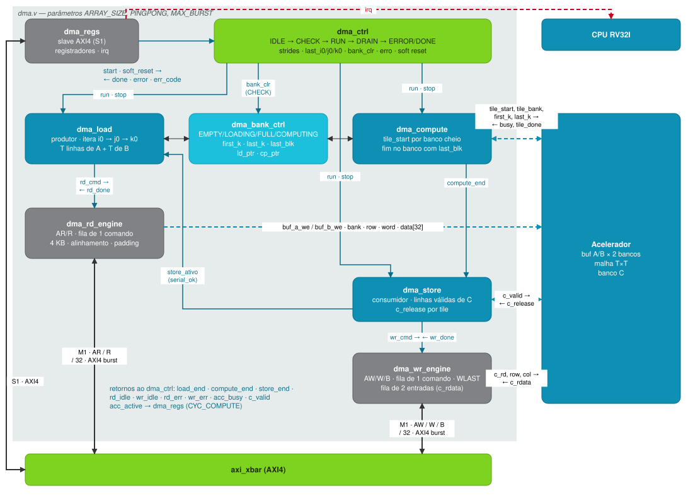

Fonte editável: [`img/dma_blocks.drawio`](img/dma_blocks.drawio).

### 5.1 Parâmetros do `dma.v`

| Parâmetro | Default | Faixa | Uso |
|---|---|---|---|
| `ARRAY_SIZE` | 4 | 2, 4, 8 | T. Precisa ser igual ao do acelerador |
| `PINGPONG` | 1 | 0, 1 | 1 = prefetch com 2 bancos + banco C; 0 = operação serial |
| `MAX_BURST` | 16 | 1 … 16 | Maior burst emitido. Valores < 16 servem para testar a divisão de bursts |
| `ADDR_W` | 32 | 32 | |
| `DATA_W` | 32 | 32 | |
| `ID_W` | 1 | 1 | |

### 5.2 Portas do `dma.v`

| Grupo | Sinal | Dir. | Largura | Descrição |
|---|---|---|---|---|
| Global | `clk`, `rst_n` | in | 1 | Clock e reset assíncrono ativo em 0 |
| Interrupção | `irq` | out | 1 | `STATUS.DONE ∧ CTRL.IRQ_EN` (nível) |
| Slave S1 (regs) | `s_aw*`, `s_w*`, `s_b*`, `s_ar*`, `s_r*` | — | perfil 4.2 | Porta AXI4 slave do banco de registradores, com `S_ID_W` = 2 (vem do xbar) |
| Master M1 | `m_aw*`, `m_w*`, `m_b*`, `m_ar*`, `m_r*` | — | perfil 4.2 | Porta AXI4 master para a DMEM |
| Acelerador | `buf_a_we`, `buf_b_we` | out | 1 | Escrita de uma palavra no buffer A ou B |
| | `buf_bank` | out | 1 | Banco de destino (sempre 0 com `PINGPONG=0`) |
| | `buf_row` | out | IW | Linha do buffer |
| | `buf_word` | out | WW | Palavra dentro da linha (colunas 4·w … 4·w+3) |
| | `buf_wdata` | out | 32 | 4 int8, lane 0 = menor coluna; lanes de padding valem 0 |
| | `tile_start` | out | 1 | Pulso: inicia o tile |
| | `tile_bank` | out | 1 | Banco que o tile usa (amostrado com `tile_start`) |
| | `first_k`, `last_k` | out | 1 | Amostrados com `tile_start`: primeiro / último bloco k0 do tile |
| | `busy` | in | 1 | Malha ocupada (inclui a espera pelo banco C). Dentro do DMA este sinal se chama **`acc_busy`**, para não confundir com `STATUS.BUSY` |
| | `acc_active` | in | 1 | Malha calculando (estado `A_RUN` do acelerador, sem a espera pelo banco C). Conta `CYC_COMPUTE` |
| | `tile_done` | in | 1 | Pulso: tile terminou; o banco usado está livre |
| | `c_valid` | in | 1 | Há um C completo esperando para ser gravado |
| | `c_release` | out | 1 | Pulso: C foi gravado; o acelerador pode sobrescrevê-lo |
| | `c_rd` | out | 1 | Leitura de um elemento de C |
| | `c_row`, `c_col` | out | IW | Posição do elemento |
| | `c_rdata` | in | 32 | Valor, válido no ciclo seguinte a `c_rd` |

### 5.3 Submódulos

| Módulo | Arquivo | Função |
|---|---|---|
| `dma_regs` | `rtl/dma/dma_regs.v` | Slave AXI4 S1. Banco de registradores (seção 6), `irq`, contadores `CYCLES` (conta com `ctrl_busy`) e `CYC_COMPUTE` (conta com `acc_active`). Gera `start` e `soft_reset` (pulsos) e recebe `ctrl_busy`, `done`, `error` e `err_code` |
| `dma_ctrl` | `rtl/dma/dma_ctrl.v` | FSM principal: valida a configuração, calcula strides e limites, zera os bancos, libera as três FSMs, coordena erro, `SOFT_RESET` e dreno (9.1) |
| `dma_load` | `rtl/dma/dma_load.v` | Produtor. Percorre (i0, j0, k0), espera um banco livre e passa ao `dma_rd_engine` as T linhas de A e as T linhas de B, sem esperar cada linha terminar (9.2) |
| `dma_compute` | `rtl/dma/dma_compute.v` | Dispara cada tile quando o banco está cheio e a malha livre; repassa `first_k`/`last_k`; libera o banco no `tile_done`; termina no banco com `last_blk` (9.3) |
| `dma_store` | `rtl/dma/dma_store.v` | Consumidor. Espera `c_valid` e passa ao `dma_wr_engine` as linhas válidas de C; depois dá `c_release` (9.4) |
| `dma_rd_engine` | `rtl/dma/dma_rd_engine.v` | Dono dos canais AR/R. Guarda o comando corrente + 1 na fila. Transforma "linha de A/B" em 1 ou 2 bursts (divisão em 4 KB), alinha bytes, zera o padding e escreve no buffer (10.1) |
| `dma_wr_engine` | `rtl/dma/dma_wr_engine.v` | Dono dos canais AW/W/B. Guarda o comando corrente + 1 na fila. Transforma "linha de C" em bursts, busca os valores com `c_rd` por uma fila de 2 entradas e gera `WLAST` (10.2) |
| `dma_bank_ctrl` | dentro de `dma.v` | Estado de cada banco (EMPTY/LOADING/FULL/COMPUTING), metadados (`first_k`, `last_k`, `last_blk`) e ponteiros `ld_ptr`/`cp_ptr` (7.8). Zerado pelo `dma_ctrl` em `CHECK` (`bank_clr`) |
| `dma` | `rtl/dma/dma.v` | Top: instancia e liga os módulos; multiplexa a porta do buffer (só o `dma_rd_engine` escreve) e a porta de C (só o `dma_wr_engine` lê) |

Separar AR/R e AW/W/B em dois motores independentes é o que permite **ler o próximo bloco e gravar o C anterior ao mesmo tempo**. Os dois nunca disputam um canal.

### 5.4 Interface interna entre FSMs e motores

Comandos com handshake `valid/ready`. Cada motor guarda **o comando corrente e mais um na fila** (registrador de 1 entrada):

- **Fila livre:** `cmd_ready` vale 1, então a FSM entrega a linha seguinte enquanto o motor ainda executa a atual.
- **Fim de linha:** o motor dá um pulso de `done` e, no mesmo ciclo, puxa o comando da fila, se houver. As linhas terminam na ordem em que foram entregues.
- **Motor ocioso:** `idle` = nenhum comando corrente e fila vazia.
- **Custo:** o handshake entre FSM e motor fica escondido; o custo de uma linha é o do barramento (≈ L + beats).

**`dma_load` → `dma_rd_engine`** (uma linha de tile):

| Sinal | Largura | Descrição |
|---|---|---|
| `rd_cmd_valid` / `rd_cmd_ready` | 1 | Handshake. `rd_cmd_ready` = fila livre |
| `rd_cmd_addr` | 32 | Endereço do primeiro byte válido da linha |
| `rd_cmd_nbytes` | ⌈log₂(T+1)⌉ | Bytes válidos na linha (0 … T). 0 = linha inteira de padding, sem acesso à memória |
| `rd_cmd_sel` | 1 | 0 = buf A, 1 = buf B |
| `rd_cmd_bank` | 1 | Banco de destino |
| `rd_cmd_row` | IW | Linha do buffer |
| `rd_done` | 1 | Pulso: as `WPR` palavras de uma linha foram escritas no buffer (uma linha por pulso, na ordem dos comandos) |
| `rd_idle` | 1 | Nível: nenhum comando corrente e fila vazia |
| `rd_err` | 1 | Nível: algum `RRESP ≠ OKAY` desde o `start` (limpo pelo `dma_ctrl` em `CHECK`) |

**`dma_store` → `dma_wr_engine`** (uma linha de C):

| Sinal | Largura | Descrição |
|---|---|---|
| `wr_cmd_valid` / `wr_cmd_ready` | 1 | Handshake. `wr_cmd_ready` = fila livre |
| `wr_cmd_addr` | 32 | Endereço de C[i0+r][j0] |
| `wr_cmd_nwords` | ⌈log₂(T+1)⌉ | Elementos válidos (1 … T) |
| `wr_cmd_row` | IW | Linha r do tile (vira `c_row`) |
| `wr_done` | 1 | Pulso: todos os B de uma linha chegaram (uma linha por pulso, na ordem dos comandos) |
| `wr_idle` | 1 | Nível: nenhum comando corrente e fila vazia |
| `wr_err` | 1 | Nível: algum `BRESP ≠ OKAY` desde o `start` (limpo pelo `dma_ctrl` em `CHECK`) |

---

## 6. Banco de registradores (slave S1)

Base `0x4000_0000`. Registradores de 32 bits, acessados com `lw`/`sw`. O mapa do README §3.2 se mantém; as mudanças estão marcadas com **(v2)**.

| Offset | Nome | Acesso | Reset | Campos |
|---|---|---|---|---|
| `0x00` | `CTRL` | R/W | 0 | `[0] START` (escrever 1 dispara; lê 0) · `[1] IRQ_EN` · `[2] SOFT_RESET` (escrever 1 aborta com dreno, seção 13; lê 0) |
| `0x04` | `STATUS` | R / W1C | 0 | `[0] BUSY` (RO; = `ctrl_busy`, 9.1) · `[1] DONE` (W1C) · `[2] ERROR` (W1C) · `[7:4] ERR_CODE` (RO; 1 = dimensão zero, 2 = endereço desalinhado, 3 = erro em leitura, **4 = erro em escrita (v2)**) |
| `0x08` | `ADDR_A` | R/W | 0 | Endereço-base de A. Os 32 bits guardam o valor escrito, inclusive `[1:0]`; o `CHECK` exige `[1:0] = 0` (senão `ERR_CODE = 2`) **(v2)** |
| `0x0C` | `ADDR_B` | R/W | 0 | Endereço-base de B (mesma regra) |
| `0x10` | `ADDR_C` | R/W | 0 | Endereço-base de C (mesma regra) |
| `0x14` | `DIM_M` | R/W | 0 | `[15:0]` M |
| `0x18` | `DIM_N` | R/W | 0 | `[15:0]` N |
| `0x1C` | `DIM_K` | R/W | 0 | `[15:0]` K |
| `0x20` | `CYCLES` | RO | 0 | Ciclos de `START` até `DONE` (zera no `START`) |
| `0x24` | `INFO` | RO | — | `[7:0] ARRAY_SIZE` · `[15:8]` = 8 (operando) · `[23:16]` = 32 (acumulador) · **`[27:24]` versão = 2 · `[28] PINGPONG` (v2)** |
| `0x28` | **`CYC_COMPUTE` (v2)** | RO | 0 | Ciclos com `acc_active = 1` (malha calculando, sem contar a espera pelo banco C) desde o `START`. `CYC_COMPUTE / CYCLES` = taxa de uso da malha |

### 6.1 Regras

- **Interrupção:** `irq = STATUS.DONE ∧ CTRL.IRQ_EN` (nível). Cai quando o firmware escreve 1 em `STATUS.DONE`.
- **Com `BUSY = 1`:** escritas em `ADDR_*`, `DIM_*` e um novo `START` são ignoradas. `SOFT_RESET` e `IRQ_EN` continuam aceitos.
- **`START`:**
  - Zera `CYCLES`, `CYC_COMPUTE`, `DONE`, `ERROR` e `ERR_CODE`.
  - Gera um pulso de `start` para o `dma_ctrl`.
  - `BUSY` sobe no ciclo seguinte, quando o `dma_ctrl` entra em `CHECK`, e fica em 1 até o fim do `DONE` (`ctrl_busy`, 9.1). `CYCLES` conta enquanto `ctrl_busy = 1`.
- **`SOFT_RESET`:**
  - Com o DMA em `IDLE`, não tem efeito.
  - Em `CHECK`, volta direto para `IDLE`; nenhuma transação foi emitida.
  - Em `RUN`, drena (13.2) e volta para `IDLE` sem `DONE`; `STATUS` fica zerado e `CYCLES` congela.
  - Se o DMA já está em `DRAIN` por erro, é ignorado: o erro vence e termina em `DONE` com `ERROR = 1`.
- **Escrita simultânea de `START` e `SOFT_RESET`:** vale o `SOFT_RESET`.
- **Offset não mapeado:** lê 0, escrita ignorada, resposta `OKAY`.

### 6.2 Comportamento AXI4 do slave

| Pedido | Resposta |
|---|---|
| AR com `ARLEN = 0`, `ARSIZE = 2` | 1 beat: `RDATA` = registrador, `RRESP = OKAY`, `RLAST = 1`, `RID = ARID` |
| AR com `ARLEN > 0` ou `ARSIZE ≠ 2` | `ARLEN + 1` beats com `RDATA = 0`, `RRESP = SLVERR`, `RLAST` no último |
| AW + W com `AWLEN = 0` | Escreve respeitando `WSTRB`; `BRESP = OKAY` |
| AW com `AWLEN > 0` ou `AWSIZE ≠ 2` | Consome os `AWLEN + 1` beats de W até `WLAST`, sem escrever; `BRESP = SLVERR` |

Leitura e escrita são tratadas por duas FSMs pequenas e independentes:
- **Leitura:** `RS_IDLE → RS_DATA` (mantém `RVALID` até `RREADY`; conta os beats) `→ RS_IDLE`.
- **Escrita:** `WS_IDLE → WS_DATA` (aceita W; com `AWLEN > 0` só descarta) `→ WS_RESP` (`BVALID` até `BREADY`) `→ WS_IDLE`.

`AWREADY` só sobe em `WS_IDLE`, e `ARREADY` só em `RS_IDLE`.

---

## 7. Prefetch e ping-pong: necessidade e funcionamento

Esta seção responde **por que** o DMA precisa de prefetch, **quanto** isso rende e **como** funciona. O enunciado não exige prefetch. Ele exige um DMA autônomo e uma comparação de desempenho entre configurações (§6), e avalia "a qualidade da arquitetura RTL" e "a análise quantitativa dos compromissos entre paralelismo, área e desempenho" (§11). O ping-pong é uma decisão de arquitetura que mexe exatamente nesses compromissos. Por isso ele vem com o parâmetro `PINGPONG`, que permite medir o ganho em vez de só afirmar.

### 7.1 O problema sem prefetch

O DMA usa três recursos que, em princípio, podem trabalhar ao mesmo tempo:

| Recurso | Usado para |
|---|---|
| Canal de leitura AXI (AR/R) | Trazer A e B da DMEM |
| Malha sistólica | Calcular um bloco (3T − 1 ciclos) |
| Canal de escrita AXI (AW/W/B) | Gravar C na DMEM |

Com **um único banco** de A/B e com C guardado nos próprios acumuladores (o projeto da Entrega 2), eles trabalham **um de cada vez**:

1. O DMA não pode carregar o próximo bloco enquanto a malha calcula, porque sobrescreveria os operandos que a malha está lendo.
2. A malha não pode começar o próximo tile enquanto o DMA lê C, porque `first_k` zeraria os acumuladores antes de C ser gravado.
3. Durante a carga, a malha fica parada esperando dados.

Linha do tempo sem ping-pong (8×8×8, T = 4, L = 3; 2 blocos k0 por tile):

```mermaid
gantt
    title Sem ping-pong (PINGPONG = 0) — um recurso de cada vez
    dateFormat X
    axisFormat %s
    section Leitura AXI
    Bloco t0.k0  :0, 32
    Bloco t0.k1  :43, 75
    Bloco t1.k0  :114, 146
    section Malha
    Calc t0.k0   :32, 43
    Calc t0.k1   :75, 86
    Calc t1.k0   :146, 157
    section Escrita AXI
    C do tile 0  :86, 114
```

Nos 157 ciclos mostrados, a malha trabalha só 33 (21 %). O canal de leitura fica parado sempre que a malha calcula ou o C é gravado.

### 7.2 Custo de cada fase

Fórmulas do modelo analítico (L = latência de leitura, ~3 ciclos; `W_OV` = custo fixo de um burst de escrita, AW + resposta B, ~3 ciclos):

| Fase | Fórmula | Origem |
|---|---|---|
| Carga de um bloco (A e B) | `2T · (L + ⌈T/4⌉)` | 2T linhas; cada linha = 1 burst de ⌈T/4⌉ beats + latência |
| Cálculo de um bloco | `3T − 1` | README §5 |
| Gravação de um tile de C | `T · (T + W_OV)` | T linhas; cada linha = 1 burst de T beats + custo fixo |

| T | Carga/bloco | Cálculo/bloco | Gravação/tile |
|---|---|---|---|
| 2 | 16 | 5 | 10 |
| 4 | 32 | 11 | 28 |
| 8 | 80 | 23 | 88 |

Duas observações guiam o projeto:
- **A carga domina o cálculo** em todas as configurações (16 × 5, 32 × 11, 80 × 23). A malha está limitada pela memória, não pelo cálculo.
- **A gravação de C cresce com T²** e, em T = 8, passa a ser a maior fase de todas (88 ciclos).

### 7.3 Por que 2 bancos de A/B

Com dois bancos, enquanto a malha calcula com o banco 0, o `dma_rd_engine` carrega o próximo bloco no banco 1. Esse próximo bloco é o k0 seguinte ou o primeiro bloco do próximo tile. No fim do cálculo, os papéis trocam.

O tempo de cálculo fica **escondido atrás da carga**: o custo de um bloco cai de `carga + cálculo` para `max(carga, cálculo)`. Sem o segundo banco isso é impossível, porque o DMA escreveria nos operandos em uso.

### 7.4 Por que o banco de C

Os dois bancos de A/B não bastam. No último bloco de um tile, os acumuladores guardam o resultado final, e o próximo tile (que começa com `first_k = 1`) os zeraria. Sem um lugar para guardar C, a malha precisa esperar a gravação inteira, e a gravação é a fase mais longa em T = 8.

Com o **banco C**, o acelerador copia os T² acumuladores para registradores de saída em **um ciclo**, no fim do tile, e já pode começar o próximo. O `dma_wr_engine` grava C a partir do banco enquanto a malha calcula e o `dma_rd_engine` carrega, tudo ao mesmo tempo.

Linha do tempo com ping-pong (mesmo caso da 7.1):

```mermaid
gantt
    title Com ping-pong (PINGPONG = 1) — três recursos em paralelo
    dateFormat X
    axisFormat %s
    section Leitura AXI
    Bloco t0.k0 → banco 0  :0, 32
    Bloco t0.k1 → banco 1  :32, 64
    Bloco t1.k0 → banco 0  :64, 96
    Bloco t1.k1 → banco 1  :96, 128
    section Malha
    Calc t0.k0 (banco 0)   :32, 43
    Calc t0.k1 (banco 1)   :64, 75
    Calc t1.k0 (banco 0)   :96, 107
    Calc t1.k1 (banco 1)   :128, 139
    section Escrita AXI
    C do tile 0 (banco C)  :75, 103
    C do tile 1 (banco C)  :139, 167
```

O canal de leitura fica ocupado sem parar. Os dois primeiros tiles terminam em 167 ciclos, contra 228 sem ping-pong.

### 7.5 Ganho estimado

Modelo analítico em ciclos (fórmulas na 14.1). A coluna "Só A/B" mostra o que se perderia sem o banco C: com os 2 bancos de A/B mas sem o banco C, a gravação de cada tile volta a ser serial, `tiles · (kb · max(Ld, Cp) + St) + Cp`.

| Caso (M×K×N) | T | Serial (`PINGPONG=0`) | Só A/B | A/B + C (`PINGPONG=1`) | Ganho |
|---|---|---|---|---|---|
| 8×8×8 | 2 | 1504 | 1189 | 1039 | 31 % |
| 8×8×8 | 4 | 456 | 379 | 295 | 35 % |
| 8×8×8 | 8 | 191 | 191 | 191 | 0 % |
| 16×16×16 | 4 | 3200 | 2507 | 2087 | 35 % |
| 16×16×16 | 8 | 1176 | 1015 | 751 | 36 % |
| 6×5×7 | 4 | 456 | 379 | 295 | 35 % |

Como ler esses números:

1. **De onde vem o ganho:** de esconder cálculo e gravação atrás da carga, que é a fase dominante.
   - **Teto do ganho:** com muitos tiles (sem enchimento e esvaziamento do pipeline) e `kb · Ld ≥ St`, o ganho tende a `(kb · Cp + St) / (kb · (Ld + Cp) + St)`. Isso dá ≈ 44 % em T = 4 com kb = 2 e ≈ 46 % em T = 8 com kb = 2.
   - **Valores da tabela:** os ≈ 35 % são menores porque os casos têm poucos tiles, e o primeiro bloco e o último C não se sobrepõem a nada.
   - **Com K grande:** kb cresce, St pesa menos, e o ganho cai para perto de `Cp / (Ld + Cp)` (≈ 26 % em T = 4).
2. **Quando não há ganho:** com 1 tile e 1 bloco (matriz ≤ T, como 8×8×8 em T = 8) não existe "próximo bloco" para buscar. O ping-pong só paga quando há vários blocos ou tiles, que é justamente o caso do tiling, um requisito do enunciado (§4).
3. **O modelo é um limite superior:** a DMEM é uma SRAM **single-port** (seção 12.2). Leitura e escrita do DMA disputam o `axi_mem_ctrl`, que atende uma transação por vez, então o ganho real fica abaixo do estimado. Por isso o `PINGPONG=0` existe: o número final vem de `CYCLES` medido em simulação, não desta tabela.

### 7.6 Custo

| Item | `PINGPONG=0` | `PINGPONG=1` | Extra em T = 8 |
|---|---|---|---|
| Buffers A/B | 2T² bytes | 4T² bytes | +128 bytes (1024 FFs) |
| Banco C | — | T² × 32 FFs | +2048 FFs |
| Mux de leitura de C | Sobre os acumuladores | Sobre o banco C | ≈ igual |
| Controle no DMA | 3 FSMs, sempre um banco | 3 FSMs + estado de 2 bancos + ponteiros | Pequeno |
| Verificação | — | Riscos de conflito de banco (7.8) | Asserções + casos com vários tiles |

Na síntese, isso entra como mais uma dimensão do trade-off **paralelismo × área**: T = 2, 4, 8 × `PINGPONG` = 0, 1 (seção 15).

### 7.7 Relação com o enunciado e com a nota

- **Requisitos obrigatórios (§3, §5, §6):** atendidos nos dois modos. Com `PINGPONG=0` o DMA é o mesmo do README, só que com burst.
- **Critério §11 ("análise quantitativa dos compromissos"):** os pares (`PINGPONG`, T) dão área, Fmax e `CYCLES` medidos, que entram no relatório (§10.c.iii).
- **Risco:** é mais lógica para verificar. A mitigação é testar os dois modos com os mesmos casos e comparar ambos com o golden model.

### 7.8 Funcionamento dos bancos

Cada banco de A/B tem um estado, guardado no `dma_bank_ctrl` (o acelerador não precisa saber):

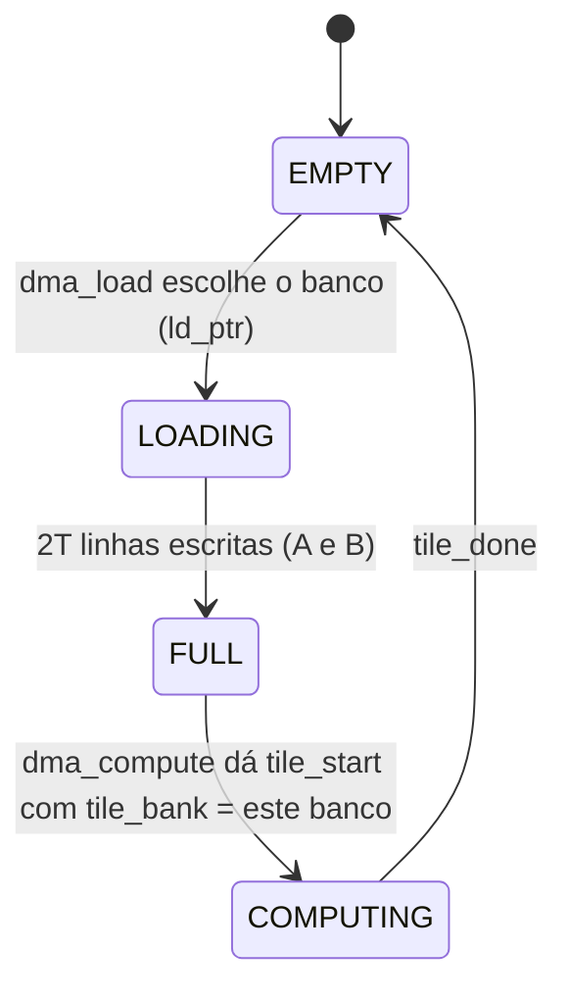

O banco C tem o estado no próprio acelerador (`c_valid`):

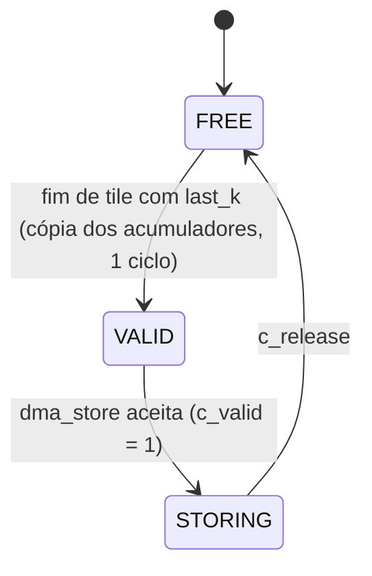

**Ponteiros:**
- `ld_ptr`: banco que o load usa no próximo bloco.
- `cp_ptr`: banco que o compute usa no próximo tile.

Os dois começam em 0 e alternam (`^= 1`) a cada bloco. Com `PINGPONG=0` ficam sempre em 0. Como load e compute percorrem os blocos na mesma ordem i0 → j0 → k0 e alternam do mesmo jeito, o compute sempre pega o bloco certo e a ordem do golden model se mantém.

**Metadados por banco:** gravados pelo `dma_load` em `L_BLOCK_DONE` e lidos pelo `dma_compute`:
- `first_k = (k0 = 0)`;
- `last_k = (k0 = last_k0)`;
- `last_blk` = último bloco da operação.

**Reset dos bancos:** em `CHECK`, o `dma_ctrl` dá um pulso de `bank_clr`, que leva os dois bancos a EMPTY, zera os metadados e faz `ld_ptr = cp_ptr = 0`. Assim:
- um dreno que deixou um banco LOADING ou FULL não contamina a operação seguinte;
- load e compute recomeçam sempre alinhados no banco 0.

**Regras contra conflitos (verificadas por asserções, seção 16):**

| # | Regra | Quem garante |
|---|---|---|
| H1 | O load só escreve num banco EMPTY/LOADING, nunca FULL ou COMPUTING | `dma_load` espera `bank_state[ld_ptr] = EMPTY` |
| H2 | O compute só dispara com o banco FULL e `acc_busy = 0` | `dma_compute` |
| H3 | A cópia dos acumuladores para o banco C só acontece com `c_valid = 0` | Acelerador: se `c_valid = 1` no fim do tile, espera em `A_WAIT_C` (mantém `busy`) |
| H4 | O store só lê C com `c_valid = 1` e dá exatamente um `c_release` por tile | `dma_store` |
| H5 | Com `PINGPONG=0`, o load do primeiro bloco de um tile espera o store do tile anterior terminar | `dma_load` (condição `serial_ok`, 9.2) |
| H6 | Nenhum comando novo para os motores e nenhuma transação AXI nova com `ctrl_busy = 0` | `dma_ctrl`: só sai do DRAIN com as três FSMs em `*_END` e os motores ociosos (9.1) |
| H7 | Cada linha válida de C é gravada exatamente uma vez por operação | `dma_store` + tempo do `c_release` (9.4) |

### 7.9 Parâmetro `PINGPONG`

| Aspecto | `PINGPONG = 0` | `PINGPONG = 1` |
|---|---|---|
| Bancos de A/B (`NBANK`) | 1 | 2 |
| Banco C | Não existe; `c_rdata` lê os acumuladores direto | Existe; `c_rdata` lê o banco C |
| `c_valid` | 1 entre o `tile_done` com `last_k` e o `c_release` | 1 entre a cópia e o `c_release` |
| Load | Espera o banco único ficar EMPTY **e** (no primeiro bloco de um tile) o store anterior terminar | Espera o banco `ld_ptr` ficar EMPTY |
| Comportamento | Igual ao README §6: carga → cálculo → gravação | Três estágios sobrepostos |
| FSMs | As mesmas; só mudam as condições de "banco livre" | — |

**Plano de medição** (entra no relatório final):

| T | `PINGPONG` | Área (síntese) | Fmax (síntese) | `CYCLES` 8×8×8 | `CYCLES` 16×16×16 | `CYC_COMPUTE/CYCLES` |
|---|---|---|---|---|---|---|
| 2, 4, 8 | 0, 1 | medido | medido | medido | medido | medido |

---

## 8. Fluxo de operação

### 8.1 Sequência completa

```mermaid
sequenceDiagram
    participant CPU
    participant REGS as dma_regs (S1)
    participant CTRL as dma_ctrl
    participant LD as dma_load + rd_engine
    participant CP as dma_compute
    participant ST as dma_store + wr_engine
    participant ACC as Acelerador
    participant MEM as DMEM (axi_mem_ctrl)
    CPU->>REGS: sw ADDR_A/B/C, DIM_M/N/K (AXI4, AWLEN=0)
    CPU->>REGS: sw CTRL = START | IRQ_EN
    REGS->>CTRL: start
    CTRL->>CTRL: CHECK (dimensões, alinhamento, strides)
    CTRL->>LD: run
    CTRL->>CP: run
    CTRL->>ST: run
    Note over CPU: wfi
    par carga (banco ld_ptr)
        LD->>MEM: AR burst por linha de A e B
        MEM-->>LD: R beats (4 × int8)
        LD->>ACC: buf_a_we / buf_b_we (bank, row, word, data[32])
    and cálculo (banco cp_ptr)
        CP->>ACC: tile_start (tile_bank, first_k, last_k)
        ACC-->>CP: tile_done
    and gravação (banco C)
        ACC-->>ST: c_valid
        ST->>ACC: c_rd (row, col)
        ACC-->>ST: c_rdata
        ST->>MEM: AW + W burst por linha de C
        MEM-->>ST: B OKAY
        ST->>ACC: c_release
    end
    LD-->>CTRL: load_end
    CP-->>CTRL: compute_end
    ST-->>CTRL: store_end
    CTRL->>REGS: done
    REGS->>CPU: irq
    CPU->>REGS: lw STATUS; sw STATUS = DONE (W1C)
```

### 8.2 Valores calculados no CHECK

Calculados uma vez no `dma_ctrl` e mantidos em registradores durante a operação:

| Valor | Fórmula | Largura |
|---|---|---|
| `STRIDE_A` | `((K + 3) >> 2) << 2` | 18 |
| `STRIDE_B` | `((N + 3) >> 2) << 2` | 18 |
| `STRIDE_C` | `N << 2` | 18 |
| `last_i0`, `last_j0`, `last_k0` | Maior múltiplo de T menor que M, N, K: `(X − 1) & ~(T − 1)` | 16 |

**Nenhum valor exige multiplicador:**
- Os strides são deslocamentos e somas.
- `last_*` é uma máscara.
- Os produtos `(i0 + r) · STRIDE` dos endereços viram ponteiros de linha que somam o stride a cada linha (seção 10.4).
- O fim da operação não usa contagem de tiles ou blocos: o `dma_load` marca o último bloco (`i0 = last_i0 ∧ j0 = last_j0 ∧ k0 = last_k0`) com `last_blk` (7.8); o `dma_compute` termina ao liberar esse banco; o `dma_store` termina no tile `(last_i0, last_j0)`.

### 8.3 Exemplo numérico: 6×5×7, T = 4

M = 6, K = 5, N = 7. `ADDR_A = 0x1000_1000`, `ADDR_B = 0x1000_4000`, `ADDR_C = 0x1000_8000`.
`STRIDE_A = 8`, `STRIDE_B = 8`, `STRIDE_C = 28`. São 2 × 2 tiles com 2 blocos k0 cada, ou seja, 8 blocos.

**Cargas.** Uma linha = 1 burst de 1 beat (`ARLEN = 0`, `WPR = 1`). "Zero" = linha de padding, sem AR.

| Bloco (i0, j0, k0) | Banco (`PP=1`) | Linhas de A: endereço / bytes válidos | Linhas de B: endereço / bytes válidos |
|---|---|---|---|
| (0, 0, 0) | 0 | i = 0…3: `0x1000_1000` + 8i / 4 | k = 0…3: `0x1000_4000` + 8k / 4 |
| (0, 0, 4) | 1 | i = 0…3: `0x1000_1004` + 8i / 1 | k = 4: `0x1000_4020` / 4; k = 5…7: zero |
| (0, 4, 0) | 0 | igual a (0, 0, 0) | k = 0…3: `0x1000_4004` + 8k / 3 |
| (0, 4, 4) | 1 | igual a (0, 0, 4) | k = 4: `0x1000_4024` / 3; k = 5…7: zero |
| (4, 0, 0) | 0 | i = 4, 5: `0x1000_1020`, `0x1000_1028` / 4; i = 6, 7: zero | igual a (0, 0, 0) |
| (4, 0, 4) | 1 | i = 4, 5: `0x1000_1024`, `0x1000_102C` / 1; i = 6, 7: zero | igual a (0, 0, 4) |
| (4, 4, 0) | 0 | igual a (4, 0, 0) | igual a (0, 4, 0) |
| (4, 4, 4) | 1 | igual a (4, 0, 4) | igual a (0, 4, 4) |

"Bytes válidos = 1" significa que o `dma_rd_engine` escreve `{0, 0, 0, byte0}` no buffer: as lanes 1–3 (colunas 5–7, além de K = 5) valem zero.

**Gravações de C.** Uma linha por burst; `AWLEN = nwords − 1`.

| Tile (i0, j0) | Linhas gravadas | Endereços | `nwords` / `AWLEN` |
|---|---|---|---|
| (0, 0) | i = 0…3 | `0x1000_8000`, `0x1000_801C`, `0x1000_8038`, `0x1000_8054` | 4 / 3 |
| (0, 4) | i = 0…3 | `0x1000_8010`, `0x1000_802C`, `0x1000_8048`, `0x1000_8064` | 3 / 2 |
| (4, 0) | i = 4, 5 | `0x1000_8070`, `0x1000_808C` | 4 / 3 |
| (4, 4) | i = 4, 5 | `0x1000_8080`, `0x1000_809C` | 3 / 2 |

Total: 44 bursts de leitura (26 nos tiles com i0 = 0 e 18 nos tiles com i0 = 4; os outros 20 pedidos de linha são padding, sem acesso), 12 bursts de escrita e 42 palavras de C (= 6 × 7).

---

## 9. Máquinas de estado

Todas as FSMs seguem a seção 15: estados como `localparam`, registrador de estado + lógica de próximo estado, saídas que vão para o AXI registradas.

**Convenções das tabelas:**
- **Valores antigos:** as condições usam os valores do ciclo atual, **antes** das atualizações da coluna "Ações". Ex.: em `L_ROW`, `r < T − 1` compara o `r` atual e `r += 1` vale a partir do ciclo seguinte.
- **Prioridade:** as linhas de um estado são avaliadas de cima para baixo e vale a primeira condição verdadeira. Sem condição verdadeira, a FSM fica no estado.
- **Nomes de `busy`:** `acc_busy` é a porta `busy` do acelerador; `ctrl_busy` é o `STATUS.BUSY`.
- **Atribuições nas transições:** o que aparece entre parênteses na coluna "Próximo" é feito na transição.

### 9.1 `dma_ctrl` — controle principal

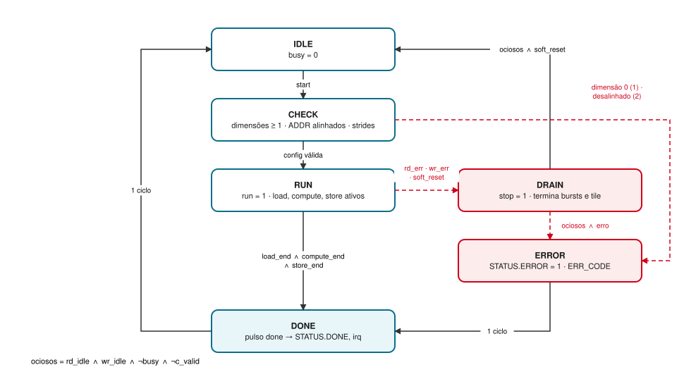

| Estado | Ações / saídas | Condição | Próximo |
|---|---|---|---|
| `IDLE` | `ctrl_busy = 0`; `run = 0`; `stop = 0` | `start` | `CHECK` |
| `CHECK` | `ctrl_busy = 1`; valida `DIM_* ≥ 1` e `ADDR_*[1:0] = 0`; calcula os valores da 8.2; zera `rd_err`/`wr_err`; pulso de `bank_clr` (bancos → EMPTY, `ld_ptr = cp_ptr = 0`, 7.8) | `soft_reset` | `IDLE` |
| | | Dimensão 0 → `err_code = 1`; senão, desalinhado → `err_code = 2` | `ERROR` |
| | | Válido | `RUN` |
| `RUN` | `ctrl_busy = 1`; `run = 1` (libera load, compute e store) | `rd_err ∨ wr_err` → `err_code = 3` (leitura) ou `4` (escrita; se os dois, vale o 3) | `DRAIN` (`abort = 0`) |
| | | `soft_reset` | `DRAIN` (`abort = 1`) |
| | | `load_end ∧ compute_end ∧ store_end` | `DONE` |
| `DRAIN` | `ctrl_busy = 1`; `run = 1`; `stop = 1`: as FSMs param na linha em andamento (13.2). `abort` e `err_code` ficam congelados: um erro ou `soft_reset` que chegue agora não muda o desfecho | `quieto ∧ ¬abort` | `ERROR` |
| | | `quieto ∧ abort` | `IDLE` (`STATUS` zerado, sem `DONE`) |
| `ERROR` | `ctrl_busy = 1`; `run = 0`; `error = 1`, `err_code` para `dma_regs` | 1 ciclo | `DONE` |
| `DONE` | `ctrl_busy = 1`; `run = 0`; pulso de `done` para `dma_regs` (`STATUS.DONE = 1`, congela `CYCLES`) | 1 ciclo | `IDLE` |

`quieto = load_end ∧ compute_end ∧ store_end ∧ rd_idle ∧ wr_idle ∧ ¬acc_busy ∧ ¬c_valid`.

As três FSMs só chegam a `*_END` depois de esperar as próprias linhas pendentes. Os motores ociosos garantem que nenhum burst ficou aberto. Assim, ao sair do `DRAIN`, nada mais é emitido (H6).

`run` vale 1 em `RUN` e `DRAIN`. As FSMs ficam em `*_END` até `run` cair (em `ERROR`, `DONE` ou `IDLE`).

### 9.2 `dma_load` — produtor de blocos

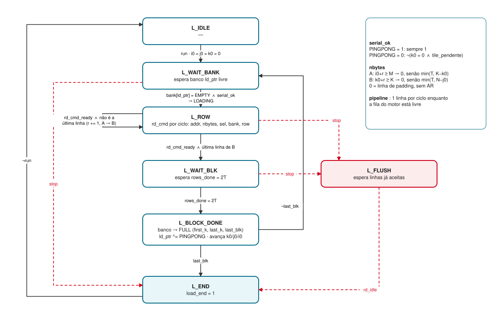

Registradores:
- `i0`, `j0`, `k0` (16 bits): canto do bloco atual.
- `r` (IW bits): linha dentro do bloco.
- `sel` (0 = A, 1 = B).
- `row_a0`, `row_b0`, `ptr_a`, `ptr_b`: ponteiros de endereço (10.4).
- `rows_done` (⌈log₂(2T+1)⌉ bits): linhas do bloco já concluídas pelo motor. Incrementa a cada `rd_done`, em `L_ROW` e `L_WAIT_BLK`.

| Estado | Ações / saídas | Condição | Próximo |
|---|---|---|---|
| `L_IDLE` | — | `run` | `L_WAIT_BANK` (i0 = j0 = k0 = 0; `row_a0 = ADDR_A`; `row_b0 = ADDR_B`) |
| `L_WAIT_BANK` | Espera um banco livre | `stop` | `L_END` |
| | | `bank_state[ld_ptr] = EMPTY ∧ serial_ok` | `L_ROW` (banco → LOADING; `r = 0`; `sel = A`; `rows_done = 0`; `ptr_a = row_a0 + k0`) |
| `L_ROW` | `rd_cmd_valid = ¬stop`; `rd_cmd_*` = linha `r` de `sel` (`addr` = `ptr_a`/`ptr_b`, `nbytes` da 10.1, `bank = ld_ptr`, `row = r`) | `stop` | `L_FLUSH` |
| | | `rd_cmd_ready ∧ r < T − 1` | `L_ROW` (`r += 1`; `ptr_a += STRIDE_A` ou `ptr_b += STRIDE_B`) |
| | | `rd_cmd_ready ∧ r = T − 1 ∧ sel = A` | `L_ROW` (`sel = B`; `r = 0`; `ptr_b = row_b0 + j0`) |
| | | `rd_cmd_ready ∧ r = T − 1 ∧ sel = B` | `L_WAIT_BLK` |
| `L_WAIT_BLK` | Espera as 2T linhas do bloco | `stop` | `L_FLUSH` |
| | | `rows_done = 2T` | `L_BLOCK_DONE` |
| `L_FLUSH` | Não emite mais comandos; espera as linhas já aceitas (no máximo a corrente e a da fila do motor) | `rd_idle` | `L_END` (o banco fica LOADING até o próximo `bank_clr`) |
| `L_BLOCK_DONE` | Banco → FULL com metadados `first_k = (k0 = 0)`, `last_k = (k0 = last_k0)`, `last_blk = (i0 = last_i0 ∧ j0 = last_j0 ∧ k0 = last_k0)`; `ld_ptr ^= PINGPONG`; avança k0 → j0 → i0 e os ponteiros de linha (10.4) | `last_blk` | `L_END` |
| | | Senão | `L_WAIT_BANK` |
| `L_END` | `load_end = 1` | `¬run` | `L_IDLE` |

- **Pipeline:** em `L_ROW`, o load entrega uma linha por ciclo enquanto a fila do motor estiver livre. Como o motor guarda no máximo a linha corrente e uma na fila, o load fica em `L_ROW` esperando `rd_cmd_ready`, sem ciclos perdidos entre linhas.
- **`serial_ok`:** com `PINGPONG = 1` é sempre 1. Com `PINGPONG = 0` vale `¬(k0 = 0 ∧ tile_pendente)`, onde `tile_pendente` = há um tile já calculado e não gravado (`c_valid ∨ store_ativo`).
- **Linhas de padding:** a linha r de A é de padding quando `i0 + r ≥ M` (`nbytes = 0`). Para B, quando `k0 + r ≥ K`. O comando sai do mesmo jeito; o motor escreve zeros sem acessar a memória (10.1).

### 9.3 `dma_compute` — disparo dos tiles

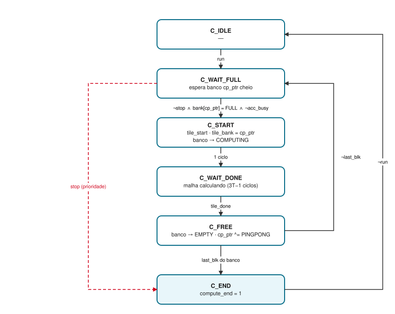

| Estado | Ações / saídas | Condição | Próximo |
|---|---|---|---|
| `C_IDLE` | — | `run` | `C_WAIT_FULL` |
| `C_WAIT_FULL` | Espera o bloco. O `stop` vem primeiro: no dreno nenhum tile novo é disparado | `stop` | `C_END` |
| | | `bank_state[cp_ptr] = FULL ∧ ¬acc_busy` | `C_START` |
| `C_START` | Pulso de `tile_start` com `tile_bank = cp_ptr` e os metadados `first_k`/`last_k` do banco; banco → COMPUTING | 1 ciclo | `C_WAIT_DONE` |
| `C_WAIT_DONE` | Espera a malha (inclui a espera interna pelo banco C, H3). Com `stop`, o tile em andamento termina normalmente | `tile_done` | `C_FREE` |
| `C_FREE` | Banco → EMPTY; `cp_ptr ^= PINGPONG` | `last_blk` do banco liberado | `C_END` |
| | | Senão | `C_WAIT_FULL` |
| `C_END` | `compute_end = 1` | `¬run` | `C_IDLE` |

Em `C_WAIT_FULL` o acelerador está sempre livre (só o `dma_compute` dispara tiles). O teste `¬acc_busy` fica como proteção e é verificado pela asserção H2.

### 9.4 `dma_store` — gravação de C

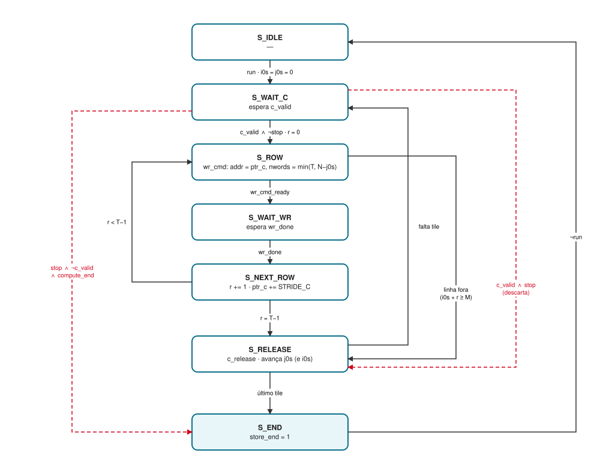

Registradores:
- `i0s`, `j0s`: tile sendo gravado.
- `r`: linha do tile.
- `row_c0`, `ptr_c`: ponteiros de endereço (10.4).
- `issued`: linhas entregues ao motor neste tile.
- `rows_done`: linhas concluídas. Incrementa a cada `wr_done`, em `S_ROW` e `S_WAIT_TILE`.

| Estado | Ações / saídas | Condição | Próximo |
|---|---|---|---|
| `S_IDLE` | — | `run` | `S_WAIT_C` (i0s = j0s = 0; `row_c0 = ADDR_C`) |
| `S_WAIT_C` | Espera um tile completo | `c_valid ∧ stop` | `S_RELEASE` (descarta sem gravar, 13.2) |
| | | `c_valid` | `S_ROW` (`r = 0`; `issued = 0`; `rows_done = 0`; `ptr_c = row_c0 + 4·j0s`) |
| | | `stop ∧ compute_end` | `S_END` |
| `S_ROW` | `wr_cmd_valid = ¬stop ∧ (i0s + r < M)`; `wr_cmd_*`: `addr = ptr_c`, `nwords = min(T, N − j0s)`, `row = r` | `stop ∨ i0s + r ≥ M` | `S_WAIT_TILE` (dreno, ou linha fora da matriz: as seguintes também estão fora) |
| | | `wr_cmd_ready ∧ r < T − 1` | `S_ROW` (`r += 1`; `ptr_c += STRIDE_C`; `issued += 1`) |
| | | `wr_cmd_ready ∧ r = T − 1` | `S_WAIT_TILE` (`issued += 1`) |
| `S_WAIT_TILE` | Espera os B de todas as linhas entregues | `rows_done = issued` | `S_RELEASE` |
| `S_RELEASE` | `c_release = 1` (saída Moore, decodificada do estado); avança `j0s += T` (fim da linha de tiles: `j0s = 0`, `i0s += T`, `row_c0 += T·STRIDE_C`) | `i0s = last_i0 ∧ j0s = last_j0` | `S_END` |
| | | Senão | `S_WAIT_C` |
| `S_END` | `store_end = 1` | `¬run` | `S_IDLE` |

**Tempo do `c_release` (H7):** `c_release` vale 1 durante o único ciclo em `S_RELEASE`. O acelerador zera `c_valid` na borda que encerra esse ciclo. No ciclo seguinte o store está em `S_WAIT_C` e já vê o valor novo:
- 0, se não há outro tile;
- 1, se o acelerador já copiou o próximo tile para o banco C. Nesse caso é um tile novo, não o mesmo.

Um `c_release` registrado (atrasado um ciclo) faria o store ver o `c_valid` antigo e gravar o mesmo tile de novo no endereço do próximo, por isso é proibido.

`store_ativo` (usado no `serial_ok`) = estado ∈ {`S_ROW`, `S_WAIT_TILE`, `S_RELEASE`}.

### 9.5 Motores AXI

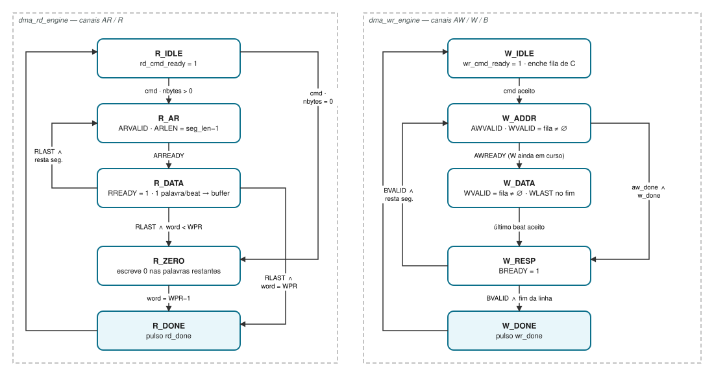

Os dois motores têm um registrador de comando corrente e uma fila de 1 entrada (5.4).
- **Carregar:** mover o comando da fila para o corrente, calcular o primeiro segmento (10.3) e zerar `word`/`col`.
- **Fim de linha:** pulso de `done` e, no mesmo ciclo, carrega a fila se houver comando. O próximo estado é:
  - `R_AR`/`W_ADDR`, se carregou um comando com dados;
  - `R_ZERO`, se carregou uma linha de padding;
  - `R_IDLE`/`W_IDLE`, se a fila estava vazia.

**`dma_rd_engine`** (`rd_cmd_ready` = fila vazia; `rd_idle` = `R_IDLE` ∧ fila vazia)

| Estado | Ações / saídas | Condição | Próximo |
|---|---|---|---|
| `R_IDLE` | Sem comando corrente; carrega a fila se houver comando | Fila com `nbytes = 0` | `R_ZERO` |
| | | Fila com `nbytes > 0` | `R_AR` |
| `R_AR` | `ARVALID = 1`; `ARADDR = seg_addr`; `ARLEN = seg_len − 1` | `ARREADY` | `R_DATA` |
| `R_DATA` | `RREADY = 1`; a cada beat escreve a palavra `word` no buffer (lanes alinhadas e mascaradas, 10.1) e faz `word += 1`; `RRESP ≠ OKAY` → `rd_err = 1` | `RVALID ∧ RLAST ∧ resta segmento` | `R_AR` (próximo segmento) |
| | | `RVALID ∧ RLAST ∧ word < WPR − 1` | `R_ZERO` (completa a linha com zeros) |
| | | `RVALID ∧ RLAST ∧ word = WPR − 1` | Fim de linha |
| `R_ZERO` | Escreve `buf_wdata = 0` na palavra `word`; `word += 1` | `word = WPR − 1` | Fim de linha |

**`dma_wr_engine`** (`wr_cmd_ready` = fila vazia; `wr_idle` = `W_IDLE` ∧ fila vazia)

| Estado | Ações / saídas | Condição | Próximo |
|---|---|---|---|
| `W_IDLE` | Sem comando corrente; carrega a fila se houver comando; a fila de C (10.2) começa a ler a linha | Fila com comando | `W_ADDR` (`aw_done = w_done = 0`) |
| `W_ADDR` | `AWVALID = ¬aw_done`; `WVALID = fila de C não vazia ∧ ¬w_done`; `WLAST` no último beat do segmento | `aw_ok ∧ w_ok` | `W_RESP` |
| | | `aw_ok ∧ ¬w_ok` | `W_DATA` |
| | | Senão | `W_ADDR` (atualiza `aw_done`/`w_done`) |
| `W_DATA` | `WVALID = fila de C não vazia`; `WLAST` no último beat do segmento | `w_ok` | `W_RESP` |
| `W_RESP` | `BREADY = 1`; `BRESP ≠ OKAY` → `wr_err = 1` | `BVALID ∧ resta segmento` | `W_ADDR` (próximo segmento; `aw_done = w_done = 0`) |
| | | `BVALID ∧ fim da linha` | Fim de linha |

Onde:
- `aw_ok = aw_done ∨ (AWVALID ∧ AWREADY)`;
- `w_ok = w_done ∨ (WVALID ∧ WREADY ∧ WLAST)`.

Em `W_ADDR`, AW e W andam de forma independente, e os flags `aw_done`/`w_done` registram o handshake que já ocorreu. A linha `aw_ok ∧ w_ok → W_RESP` cobre o caso em que todos os beats de W são aceitos antes do AW. `W_DATA` existe só para quando o AW é aceito antes do fim dos beats.

---

## 10. Motores AXI em detalhe

### 10.1 Leitura de uma linha de A ou B (`dma_rd_engine`)

Endereço do primeiro byte e bytes válidos, calculados pelo `dma_load`:

| Matriz | Endereço da linha r | Bytes válidos (`nbytes`) |
|---|---|---|
| A | `ADDR_A + (i0 + r)·STRIDE_A + k0` | `i0 + r ≥ M` → 0; senão `min(T, K − k0)` |
| B | `ADDR_B + (k0 + r)·STRIDE_B + j0` | `k0 + r ≥ K` → 0; senão `min(T, N − j0)` |

No motor:

1. `off = addr[1:0]` e `araddr0 = {addr[31:2], 2'b00}`.
2. **Palavras a ler:** `nwords_rd = ⌈(off + nbytes) / 4⌉`, de 1 a `WPR`.
3. **Alinhamento:**
   - T ≥ 4: k0 e j0 são múltiplos de 4 e os strides também, então `off = 0`.
   - T = 2: a linha tem 2 bytes e `off ∈ {0, 2}`, então ela sempre cabe numa palavra.
   - Em qualquer caso: `dado = RDATA >> (8·off)`.
4. **Máscara de padding:** a lane l da palavra w recebe 0 quando `4w + l ≥ nbytes`. Ela também recebe 0 quando `4w + l ≥ T` (só acontece com T = 2).
5. **Palavras não lidas:** de `nwords_rd` até `WPR − 1`, são escritas como zero em `R_ZERO`. Exemplo: T = 8 com `nbytes = 3` lê 1 palavra e escreve a segunda como zero.

O buffer recebe `buf_row = r`, `buf_word = w`, `buf_bank = bank` e `buf_a_we`/`buf_b_we` conforme `sel`. Isso acontece **uma palavra por ciclo**, no mesmo ciclo do beat (`RREADY` fica sempre em 1 em `R_DATA`, porque o buffer nunca segura).

### 10.2 Gravação de uma linha de C (`dma_wr_engine`)

| Grandeza | Fórmula |
|---|---|
| Endereço | `ADDR_C + (i0s + r)·STRIDE_C + 4·j0s` |
| Palavras | `nwords = min(T, N − j0s)` |
| `WSTRB` | `4'b1111` |

O valor de C vem do acelerador com **1 ciclo de latência** (`c_rd` no ciclo n, `c_rdata` no n+1). Para manter um beat por ciclo, o motor usa uma **fila de 2 entradas** (fila de dados de C, distinta da fila de comando da 5.4):

- A leitura começa no ciclo em que o comando é carregado (`W_IDLE` ou fim da linha anterior), com `col = 0`. O primeiro dado entra na fila no ciclo seguinte, que já é o primeiro de `W_ADDR`. Por isso `WVALID` sobe um ciclo depois de `AWVALID` (forma de onda da 4.4).
- No ciclo n, emite `c_rd` com `c_row = r` e `c_col = col` se `ocupação + em_voo < 2` e `col < nwords`; depois `col += 1`.
- No ciclo n+1, empilha `c_rdata`.
- `WVALID = fila não vazia`, `WDATA = cabeça da fila`; desempilha a cada beat aceito.

Com `WREADY` sempre em 1, sai um beat por ciclo. Com backpressure, a fila enche e a leitura de C para, sem perder dado.

### 10.3 Divisão em segmentos (4 KB e `MAX_BURST`)

Para um pedido de `rest` palavras a partir de `addr`:

```
words_to_4k = (4096 − addr[11:0]) >> 2
seg_len     = min(rest, MAX_BURST, words_to_4k)
AxLEN       = seg_len − 1
addr       += 4 · seg_len ;  rest −= seg_len   (repete até rest = 0)
```

- **Quantos segmentos:** com `MAX_BURST = 16` e linhas de até 8 palavras, uma linha gera **no máximo 2 segmentos**, e só quando cruza uma fronteira de 4 KB.
- **Exemplo:** linha de C com T = 8 começando em `0x1000_8FF0` → segmento 1: `0x1000_8FF0`, 4 beats; segmento 2: `0x1000_9000`, 4 beats.
- **Teste:** `MAX_BURST < 8` força a divisão.

### 10.4 Geração de endereços sem multiplicador

Os produtos `i·STRIDE` são substituídos por somas incrementais:

| Ponteiro | Quando muda | Atualização |
|---|---|---|
| `row_a0` (início da linha i0 de A) | Começo da operação / avanço de i0 | `ADDR_A` / `row_a0 += T·STRIDE_A` (T·STRIDE = `STRIDE << log₂T`) |
| `ptr_a` | Início do bloco / cada linha | `row_a0 + k0` / `ptr_a += STRIDE_A` |
| `row_b0` (início da linha k0 de B) | `L_BLOCK_DONE` | `row_b0 += T·STRIDE_B` quando k0 avança; `ADDR_B` quando k0 volta a 0 (avanço de j0 ou i0) |
| `ptr_b` | Início das linhas de B / cada linha | `row_b0 + j0` / `ptr_b += STRIDE_B` |
| `row_c0` (linha i0s de C) | Avanço de i0s | `ADDR_C` / `row_c0 += T·STRIDE_C` |
| `ptr_c` | Início do tile / cada linha | `row_c0 + 4·j0s` / `ptr_c += STRIDE_C` |

O caminho crítico fica em um somador de 32 bits, igual para T = 2, 4 e 8.

---

## 11. Interface DMA ↔ acelerador v2 e mudanças em `accel.v`

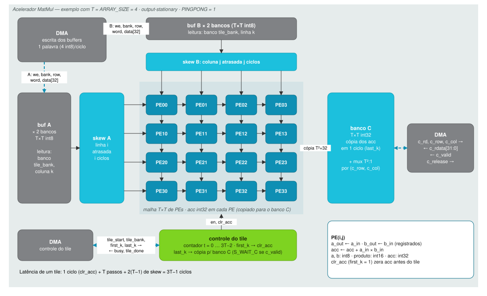

### 11.1 Sinais

| Sinal | Dir. | Largura | Descrição | Mudança |
|---|---|---|---|---|
| `buf_a_we`, `buf_b_we` | DMA→ACC | 1 | Escreve uma palavra | Igual |
| `buf_bank` | DMA→ACC | 1 | Banco (ignorado com `PINGPONG=0`) | **Novo** |
| `buf_row` | DMA→ACC | IW | Linha | Igual |
| `buf_word` | DMA→ACC | WW | Palavra: colunas `4·buf_word + l`, l = 0…3 | **Substitui `buf_col`** |
| `buf_wdata` | DMA→ACC | 32 | Lane l (`[8l+7:8l]`) → coluna `4·buf_word + l`; lanes com coluna ≥ T são ignoradas | **Era 8 bits** |
| `tile_start` | DMA→ACC | 1 | Pulso; ignorado com `busy = 1` | Igual |
| `tile_bank` | DMA→ACC | 1 | Banco usado pelo tile | **Novo** |
| `first_k` | DMA→ACC | 1 | Zera os acumuladores antes do tile | Igual |
| `last_k` | DMA→ACC | 1 | No fim do tile, publica C (cópia para o banco C ou `c_valid` com `PINGPONG=0`) | **Novo** |
| `busy` | ACC→DMA | 1 | Malha ocupada, de `A_RUN` até sair de `A_WAIT_C` (no DMA: `acc_busy`) | Igual |
| `acc_active` | ACC→DMA | 1 | 1 só em `A_RUN` (malha calculando). Usado em `CYC_COMPUTE` | **Novo** |
| `tile_done` | ACC→DMA | 1 | Pulso no fim do tile | Igual |
| `c_valid` | ACC→DMA | 1 | C completo esperando gravação (registrador) | **Novo** |
| `c_release` | DMA→ACC | 1 | Pulso de 1 ciclo: C gravado. O acelerador zera `c_valid` na borda que encerra esse ciclo, então o DMA vê `c_valid = 0` já no ciclo seguinte (9.4, H7) | **Novo** |
| `c_rd`, `c_row`, `c_col` | DMA→ACC | 1, IW, IW | Leitura de C | Igual |
| `c_rdata` | ACC→DMA | 32 | Valor no ciclo seguinte; vem do banco C (`PINGPONG=1`) ou dos acumuladores (`PINGPONG=0`) | Origem muda |

### 11.2 Mudanças internas no `accel.v`

1. **Parâmetro `PINGPONG`**, com `NBANK = PINGPONG ? 2 : 1`.
2. **Buffers:**
   - Declaração: `buf_a[0:NBANK-1][0:T-1][0:T-1]` e `buf_b` igual.
   - Escrita: lanes `l` com `4·buf_word + l < T` em `buf_x[bank][buf_row][4·buf_word + l]`.
   - Proteção: com `busy = 1`, escritas no banco `tile_bank_reg` são ignoradas (as do outro banco são aceitas).
3. **Leitura dos operandos:** o streaming lê `buf_a[tile_bank_reg]` e `buf_b[tile_bank_reg]`; `tile_bank_reg` é amostrado com `tile_start`.
4. **Banco C (`PINGPONG=1`):**
   - `reg signed [31:0] c_bank [0:T-1][0:T-1]` e `reg c_valid`.
   - Fim de tile com `last_k`:
     - Se `c_valid = 0`: copia os T² acumuladores em paralelo para `c_bank`, sobe `c_valid` e dá `tile_done`.
     - Se `c_valid = 1`: vai para o estado `A_WAIT_C` com `busy = 1` (`acc_active = 0`) e copia no primeiro ciclo em que vê `c_valid = 0`. A cópia sobe `c_valid` e dá `tile_done`.
   - `c_release = 1` num ciclo zera `c_valid` na borda que encerra esse ciclo (`c_valid <= 0`). Não há atraso adicional.
5. **`PINGPONG=0`:** no fim de tile com `last_k`, `c_valid` sobe junto com `tile_done`; `c_rdata` lê os acumuladores direto. `c_release` zera `c_valid` com a mesma regra do item 4.
6. **FSM do acelerador:** `A_IDLE` → `A_RUN` (3T − 1 ciclos, como hoje) → `A_WAIT_C` (só com `PINGPONG=1`, `last_k` e `c_valid = 1`) → `A_IDLE`. O prefixo `A_` evita confusão com os estados `S_*` do `dma_store`.
7. **`acc_active`** = `state == A_RUN`; `busy` = `state ∈ {A_RUN, A_WAIT_C}`.

A latência de um tile continua **3T − 1 ciclos**, mais a eventual espera em `A_WAIT_C`.

### 11.3 Temporização

```
ciclo            0    1    2  …  3T-1  3T   3T+1
tile_start     _/‾‾\___________________________     tile_bank = 1, first_k = 0, last_k = 1
busy           ____/‾‾‾‾‾‾‾‾‾‾‾‾‾‾‾‾‾\__________
tile_done      ______________________/‾‾\______
c_valid        ______________________/‾‾‾‾‾‾‾‾‾     cópia para o banco C no mesmo ciclo do tile_done
buf_b_we(b=0)  _______/‾‾\_/‾‾\_/‾‾\___________     o DMA carrega o banco 0 durante o cálculo no banco 1
```

### 11.4 Impacto na Entrega 2

O testbench [`tb/unit_accel/tb_accel.v`](../tb/unit_accel/tb_accel.v) injeta dados byte a byte com `buf_col`. É preciso:

1. Trocar a tarefa de escrita para palavras de 32 bits com `buf_word`.
2. Rodar os casos atuais (2×2 com vários blocos k0 e 4×4) com `PINGPONG = 0` e `1`.
3. Adicionar um caso com dois tiles seguidos, sem `c_release` entre eles, para provar a espera em `A_WAIT_C` (`busy = 1`, `acc_active = 0`).
4. Conferir que `c_valid` cai no ciclo seguinte ao pulso de `c_release`, sem atraso extra.

---

## 12. Interconexão AXI4

### 12.1 `axi_xbar` — 2 masters × 2 slaves

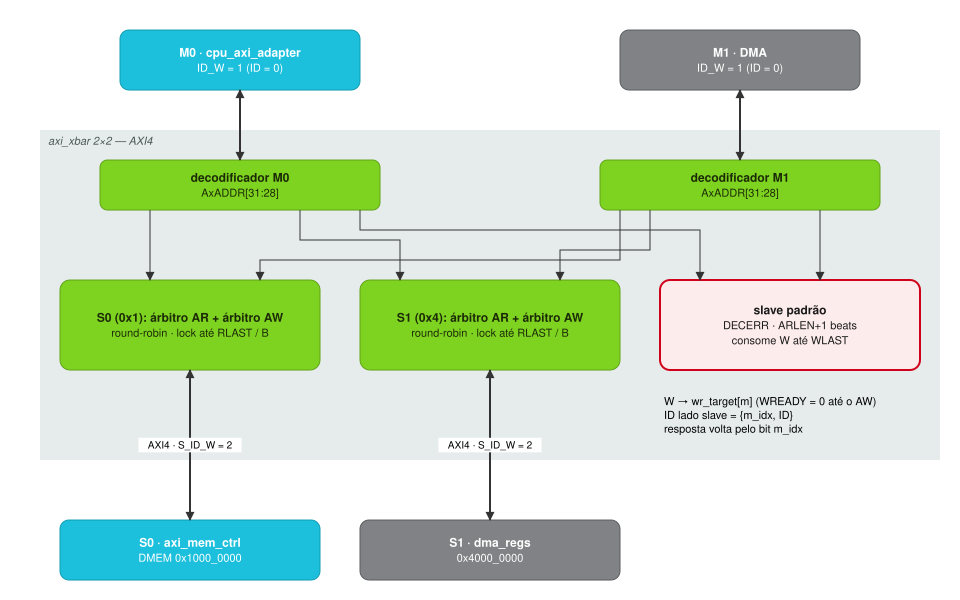

| Item | Especificação |
|---|---|
| Masters | M0 = `cpu_axi_adapter`, M1 = DMA |
| Slaves | S0 = `axi_mem_ctrl` (`addr[31:28] = 0x1`), S1 = `dma_regs` (`0x4`), slave padrão interno (demais) |
| Decodificação | Combinacional sobre `AxADDR[31:28]` só. Consequências, aceitas para manter o xbar simples:<br>• toda a faixa `0x1xxx_xxxx` vai para S0, e o `axi_mem_ctrl` responde `SLVERR` fora dos 64 KiB da DMEM (12.2);<br>• toda a faixa `0x4xxx_xxxx` vai para S1, e o `dma_regs` usa só `addr[11:2]`, então os registradores se repetem a cada 4 KiB (aliasing) e offsets não mapeados leem 0;<br>• só os demais valores de `addr[31:28]` recebem `DECERR` |
| Arbitragem | Por slave, **um árbitro de leitura e um de escrita independentes**, round-robin entre M0 e M1. A grant é registrada (1 ciclo de arbitragem) |
| Travamento | Leitura: a grant de um slave fica com o master até o handshake do beat com `RLAST`. Escrita: até o handshake de B |
| Rota de W | AXI4 não tem WID. Cada master tem no máximo uma escrita em andamento, então o W do master m vai para `wr_target[m]`, gravado no handshake de AW. Antes desse handshake, `WREADY` = 0 para o master (permitido: o master não pode esperar `WREADY` para dar `AWVALID`) |
| IDs | Lado slave: `{m_idx, AxID}` (2 bits). As respostas voltam ao master `RID[1]` / `BID[1]`, com `RID[0]` / `BID[0]` restaurados |
| Slave padrão | Responde `DECERR`. Leitura: `ARLEN + 1` beats com `RDATA = 0` e `RLAST` no último. Escrita: consome W até `WLAST` e devolve B `DECERR` |
| Concorrência | M0 lendo S1 enquanto M1 lê e grava S0 é permitido: os caminhos são independentes |
| Atraso | Depois da grant, o caminho é combinacional (sem register slice). Se a síntese mostrar caminho crítico aqui, inserir register slices é um item de risco (seção 18) |

FSM de cada árbitro (por slave e direção):
- `ARB_IDLE`: grant ao próximo master com pedido, em round-robin.
- `ARB_BUSY`: passa o canal; vai para `ARB_IDLE` no RLAST (leitura) ou no B (escrita).

### 12.2 `axi_mem_ctrl` — slave AXI4 para a DMEM

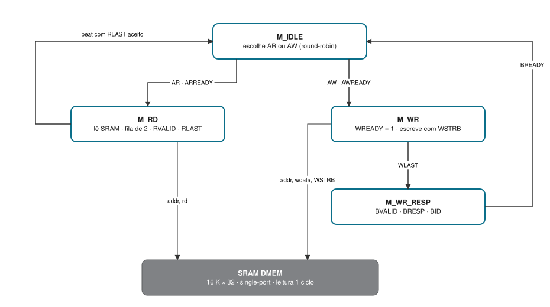

| Item | Especificação |
|---|---|
| Memória | SRAM síncrona **single-port**, 16 K palavras × 32 bits (64 KiB), escrita por byte (`WSTRB`), leitura com 1 ciclo de latência; carregada por `$readmemh` |
| Índice | `addr[15:2]`. `addr[27:16] ≠ 0` → `SLVERR` (sem aliasing) |
| Arbitragem interna | Single-port: uma transação por vez. Com AR e AW pendentes, alterna (round-robin por transação) |
| Leitura | Pipeline de 2 estágios + fila de 2 entradas: entrega **1 beat por ciclo** com `RREADY = 1`. Latência do handshake de AR ao primeiro `RVALID` = 2 ciclos |
| Escrita | `WREADY = 1` em `M_WR`; cada beat escreve a SRAM com `WSTRB`; o endereço incrementa; no `WLAST`, vai para `M_WR_RESP` |
| Fora do perfil | `AxBURST ≠ INCR` ou `AxSIZE ≠ 2`: completa os beats sem acessar a SRAM, com `SLVERR` (4.3) |

| Estado | Ações | Próximo |
|---|---|---|
| `M_IDLE` | Escolhe AR ou AW (round-robin); dá `ARREADY` ou `AWREADY` por 1 ciclo; guarda endereço, LEN e ID | `M_RD` · `M_WR` |
| `M_RD` | Lê a SRAM no endereço `a`; `a += 4` enquanto a fila tiver espaço; `RVALID` = fila não vazia; `RLAST` no último beat | `M_IDLE` após o handshake do último beat |
| `M_WR` | `WREADY = 1`; escreve cada beat; `a += 4` | `M_WR_RESP` no `WLAST` |
| `M_WR_RESP` | `BVALID = 1`, `BRESP`, `BID` | `M_IDLE` com `BREADY` |

Com a latência do xbar (1 ciclo de grant), L ≈ 3 ciclos, o valor usado no modelo da seção 7.

### 12.3 `cpu_axi_adapter` — Porta D → master AXI4 M0

Converte a interface valid/ready da Porta D (README §4.1) em transações de **1 beat**:
- `AxLEN = 0`, `AxSIZE = 2`, `AxBURST = INCR`, `ID = 0`.
- `AxADDR = {d_addr[31:2], 2'b00}`; a CPU extrai byte e half da palavra.
- Em escrita: `WSTRB = d_wstrb`, `WLAST = 1`.

| Estado | Ações | Próximo |
|---|---|---|
| `A_IDLE` | Espera `d_valid` | `A_RD` (`d_wstrb = 0`) · `A_WR` (senão) |
| `A_RD` | `ARVALID` até `ARREADY`; depois `RREADY = 1` | `A_IDLE` no beat de R: pulso de `d_ready`, `d_rdata = RRESP = OKAY ? RDATA : 0` |
| `A_WR` | `AWVALID` e `WVALID` juntos, cada um baixa no seu handshake | `A_WR_RESP` quando os dois foram aceitos |
| `A_WR_RESP` | `BREADY = 1` | `A_IDLE` no B: pulso de `d_ready` (erro ignorado, README §4.1) |

---

## 13. Erros e SOFT_RESET

### 13.1 Fontes de erro

| Fonte | Detectado em | `ERR_CODE` | Efeito |
|---|---|---|---|
| `DIM_M`, `DIM_N` ou `DIM_K` = 0 | `CHECK` | 1 | Nenhum acesso à memória; `ERROR` → `DONE` |
| `ADDR_A/B/C[1:0] ≠ 0` | `CHECK` | 2 | Idem |
| `RRESP ≠ OKAY` em qualquer beat | `dma_rd_engine` (`rd_err`) | 3 | `RUN` → `DRAIN` |
| `BRESP ≠ OKAY` | `dma_wr_engine` (`wr_err`) | 4 | `RUN` → `DRAIN` |

### 13.2 Política de dreno

AXI não permite abandonar uma transação: um burst iniciado tem que terminar. Por isso, tanto em erro quanto em `SOFT_RESET`, o DMA não volta direto para `IDLE`. Ele **drena**:

1. O `dma_ctrl` vai para `DRAIN` e sobe `stop`. `run` continua em 1.
2. **Load:** o `dma_load` para de entregar linhas no mesmo ciclo (`L_ROW`/`L_WAIT_BLK` → `L_FLUSH`). O motor de leitura termina as linhas que já aceitou, no máximo a corrente e a da fila, cada uma até o `RLAST` do último segmento. Depois o load vai para `L_END`. O banco que estava em LOADING fica assim até o próximo `CHECK`, que zera os bancos (7.8).
3. **Compute:** o `dma_compute` não dispara novos tiles e espera o tile em andamento terminar (`tile_done`). Depois vai para `C_END`.
4. **Store:** o `dma_store` para de entregar linhas (`S_ROW` → `S_WAIT_TILE`). O motor de escrita termina as linhas aceitas (no máximo 2), com todos os beats de W e o B. O tile em andamento recebe `c_release`. A partir daí, cada `c_valid` recebe `c_release` **sem gravar**, para destravar o acelerador se ele estiver esperando o banco C. O store vai para `S_END` quando `compute_end` está ativo e não há `c_valid`.
5. **Saída:** o `dma_ctrl` sai quando `quieto = load_end ∧ compute_end ∧ store_end ∧ rd_idle ∧ wr_idle ∧ ¬acc_busy ∧ ¬c_valid` (9.1):
   - em caso de erro: `ERROR` → `DONE` (`irq` sobe se `IRQ_EN`);
   - em caso de `SOFT_RESET`: `IDLE` com `STATUS` zerado, sem `DONE`.

   Exigir as três FSMs em `*_END` garante que nenhuma delas ainda tem linha a entregar quando o `ctrl_busy` cai (H6).

**Estado da memória depois de um erro:** C fica parcialmente escrito e o firmware não deve usá-lo. `CYCLES` registra até o `DONE`.

**Limite do dreno** (T = 8, sem backpressure, L ≈ 3, `W_OV` ≈ 3): o caminho mais longo é o do store. São no máximo 2 linhas de C já aceitas, ≈ 2 · (8 + 3) = 22 ciclos, mais um tile que termine nesse meio-tempo (3T − 1 = 23) e a liberação dos `c_valid` restantes (alguns ciclos). Leitura e cálculo correm em paralelo, com até 2 linhas de A/B ≈ 2 · (3 + 2) = 10 ciclos. Fica abaixo de 60 ciclos; com backpressure, cresce na mesma proporção.

---

## 14. Modelo de desempenho

### 14.1 Fórmulas

Variáveis:
- `tiles = ⌈M/T⌉·⌈N/T⌉` e `kb = ⌈K/T⌉`.
- `Ld = 2T·(L + ⌈T/4⌉)`: carga de um bloco.
- `Cp = 3T − 1`: cálculo de um bloco.
- `St = T·(T + W_OV)`: gravação de um tile.

| Modo | Ciclos (aproximação) |
|---|---|
| `PINGPONG = 0` | `tiles · (kb·(Ld + Cp) + St)` |
| `PINGPONG = 1` | `kb·Ld + (tiles − 1) · max(kb · max(Ld, Cp), St) + Cp + St` |

No `PINGPONG = 1`, a parcela `kb·Ld` é a carga do primeiro tile (enchimento do pipeline) e `Cp + St` é o cálculo e a gravação do último (esvaziamento). Cada tile intermediário custa o maior entre a carga dos seus blocos e a gravação do tile anterior: o banco C só libera quando a gravação termina. Quando `kb·Ld ≥ St`, a fórmula se reduz a `tiles · kb · Ld + Cp + St`, que é o caso de todas as linhas da 14.2. O termo `St` só domina com T = 8 e kb = 1, por exemplo 16×8×16 (T = 8, 4 tiles): 80 + 3·88 + 23 + 88 = 455 ciclos.

**O que as fórmulas não incluem:**
- Linhas de padding, mais rápidas porque não acessam a memória.
- Disputa da SRAM single-port entre leitura e escrita do DMA.
- Os ciclos de CHECK/ERROR/DONE.
- O handshake entre blocos no compute (`tile_done` → `C_FREE` → `C_WAIT_FULL` → `C_START`, ≈ 3 ciclos por bloco). Ele fica escondido atrás da carga com `PINGPONG = 1` e soma com `PINGPONG = 0`.
- O handshake entre linhas fica escondido pela fila de comando dos motores (5.4). Sem ela, cada linha custaria ≈ 4 ciclos a mais.
- **L e `W_OV` são estimativas:**
  - L = 3 inclui a arbitragem do xbar; no TB-DMA, com M1 direto na memória, L ≈ 2.
  - `W_OV` = 3 é otimista: a forma de onda da 4.4 leva T + 4 ciclos por linha de C.

**São estimativas para o projeto. O número oficial é sempre o `CYCLES` medido.**

### 14.2 Estimativas

| Caso | T | `PINGPONG=0` | `PINGPONG=1` |
|---|---|---|---|
| 8×8×8 | 2 / 4 / 8 | 1504 / 456 / 191 | 1039 / 295 / 191 |
| 16×16×16 | 2 / 4 / 8 | 11392 / 3200 / 1176 | 8207 / 2087 / 751 |
| 6×5×7 | 2 / 4 / 8 | 876 / 456 / 191 | 591 / 295 / 191 |

**Gargalo:** em regime, o canal de leitura (carga) limita tudo. O cálculo em T = 8 (23 ciclos) usa só ~29 % do tempo de carga (80 ciclos). Esse é o argumento quantitativo de que **aumentar T aumenta o paralelismo da malha, mas o ganho é limitado pela banda de memória de 32 bits**. É a conclusão que o enunciado pede no §10.c.iv.

### 14.3 Uso no relatório

- `CYCLES`: latência real (enunciado §6, "número de ciclos para a multiplicação de uma matriz de teste").
- `CYC_COMPUTE / CYCLES`: taxa de uso da malha. Mostra o efeito do ping-pong e do gargalo de memória.
- Tabela final: T × `PINGPONG` × {área, Fmax, `CYCLES`, uso}.

---

## 15. Diretrizes de codificação e síntese

### 15.1 Codificação

- **Linguagem:** Verilog-2005 (como `rtl/cpu` e `rtl/accel`). Simulação com `iverilog -g2012`.
- **Cabeçalho:** cada arquivo começa com `` `timescale 1ns/1ps `` e `` `default_nettype none ``, e termina com `` `default_nettype wire ``.
- **Constantes AXI** num include comum, `rtl/common/axi_defs.vh`: `AXI_BURST_INCR`, `AXI_SIZE_4B`, `AXI_RESP_OKAY/SLVERR/DECERR`.
- **FSM:**
  - Estados como `localparam`.
  - Um `always @(posedge clk or negedge rst_n)` para o estado e os registradores.
  - Um `always @(*)` para o próximo estado, com default no topo (sem latches).
- **Saídas para o barramento:** `AxVALID`, `WVALID`, `RVALID`, `BVALID` e os payloads saem de registradores. Os `READY` podem ser combinacionais, mas nunca dependem do `VALID` do mesmo canal no sentido oposto.
- **Reset:** assíncrono ativo em 0 (`rst_n`), como no RTL atual. Todos os `VALID` zeram no reset.
- **Nomes:**
  - Portas AXI com prefixo `s_` (slave) ou `m_` (master) e o nome da especificação em minúsculas (`m_arvalid`).
  - Sinais internos em `snake_case`.
  - Estados em maiúsculas com prefixo da FSM (`L_ROW`, `S_WAIT_C`).
- **Parâmetros:** `ARRAY_SIZE`, `PINGPONG` e `MAX_BURST` passam do top para baixo, sem `define` global.
- **Asserções:** entre `` `ifdef DMA_ASSERT `` … `` `endif ``, em Verilog simples (`if (cond) $error(...)`), para rodar no iverilog.

### 15.2 Síntese

- **Configurações:** sintetizar `accel` + `dma` para T = 2, 4, 8 e `PINGPONG` = 0, 1. São 6 configurações; o enunciado pede no mínimo 3.
- **SRAMs fora da síntese** (README §10): `axi_mem_ctrl` usa um modelo comportamental, e só a lógica de controle entra.
- **Caminhos críticos esperados:**
  - PE (multiplicador 8×8 + somador 32 bits), que não depende de T.
  - Mux de C (T²:1), que cresce com log T.
  - Somador de endereço de 32 bits no DMA.
  - Caminho combinacional do xbar.
- **Reports a guardar:** área, timing e utilização de cada configuração, em `synth/<config>/` (enunciado §10.b).

---

## 16. Plano de verificação

### 16.1 Componentes comuns (`tb/common/`)

| Arquivo | Função |
|---|---|
| `axi_checker.v` | Monitor passivo de uma interface AXI4. Verifica: `VALID` estável até o handshake; payload estável; `AxBURST = INCR`, `AxSIZE = 2`, `AxLEN ≤ 15`; burst sem cruzar 4 KB; número de beats = LEN + 1 e `LAST` só no último; B só depois de `WLAST`; no máximo 1 leitura e 1 escrita em andamento por master |
| `axi_master_bfm.v` | Tarefas `axi_write(addr, data)` e `axi_read(addr, data)` de 1 beat. Faz o papel da CPU nas Entregas 3 e 4 |
| `axi_rand_stall.v` | Fica entre master e slave e insere backpressure aleatória em `ARREADY`, `RVALID`, `AWREADY`, `WREADY` e `BVALID`, com semente configurável |

### 16.2 Testbenches

| ID | Arquivo | DUT | O que prova | Entrega |
|---|---|---|---|---|
| TB-MEM | `tb/unit_mem/tb_axi_mem_ctrl.v` | `axi_mem_ctrl` | Bursts de 1–16 beats, `WSTRB` parcial, leitura 1 beat/ciclo, SLVERR fora do perfil e fora do range, alternância AR/AW | 3 |
| TB-ACC | `tb/unit_accel/tb_accel.v` | `accel` | Regressão da Entrega 2 com porta de 32 bits; bancos; `last_k` e banco C; espera em `S_WAIT_C`; `PINGPONG` = 0/1 | 3 |
| TB-REGS | `tb/unit_dma/tb_dma_regs.v` | `dma_regs` | Leitura/escrita de cada registrador, W1C, `irq`, escrita ignorada com `BUSY`, burst → SLVERR | 3 |
| TB-RD | `tb/unit_dma/tb_dma_rd_engine.v` | `dma_rd_engine` + `axi_mem_ctrl` | Linhas com `nbytes` = 0…T, T = 2/4/8, `off` = 2 em T = 2, divisão em 4 KB, `MAX_BURST` pequeno, RRESP de erro | 3 |
| TB-WR | `tb/unit_dma/tb_dma_wr_engine.v` | `dma_wr_engine` + `axi_mem_ctrl` + modelo de C | `nwords` = 1…T, divisão em 4 KB, fila de C sob backpressure, BRESP de erro | 3 |
| TB-DMA | `tb/unit_dma/tb_dma.v` | `dma` + `axi_mem_ctrl` + `accel` (M1 ligado direto à memória; BFM nos regs) | Operação completa: DMEM carregada de `model/dmem.hex`, comparação com `model/c_expected.hex`, `irq`, `CYCLES` | **3** |
| TB-XBAR | `tb/unit_xbar/tb_axi_xbar.v` | `axi_xbar` | Decodificação, round-robin, travamento por burst, rota de W, IDs, DECERR com burst | 4 |
| TB-TOP | `tb/uvm/` | Sistema completo | UVM integrado (enunciado §7) | 4 |

### 16.3 Matriz de regressão do TB-DMA

| Casos (README §8) | T | `PINGPONG` | Backpressure | Total |
|---|---|---|---|---|
| 1 a 6 + 16×16×16 | 2, 4, 8 | 0, 1 | sem / aleatória (3 sementes) | 7 × 3 × 2 × 4 = 168 execuções |

Os vetores vêm de `python3 model/golden.py --m M --k K --n N --t T --seed S`.

### 16.4 Testes de erro

1. `DIM_K = 0` → `ERR_CODE = 1`, sem nenhum AR/AW no checker.
2. `ADDR_B = 0x1000_4002` → `ERR_CODE = 2`.
3. `ADDR_A` fora da DMEM (`0x1002_0000`) → SLVERR → `ERR_CODE = 3`, dreno completo, `DONE`, `irq`.
4. `ADDR_C = 0x2000_0000` (DECERR no xbar, Entrega 4) → `ERR_CODE = 4`.
5. `SOFT_RESET` no meio da operação → volta a `IDLE` sem transação AXI pendurada (o checker acusa se houver).

### 16.5 Critérios de aceite

- 100 % da matriz 16.3 com C idêntico ao golden model.
- Zero violação do `axi_checker` e das asserções H1–H5 (7.8).
- `PINGPONG = 1` com `CYCLES` menor ou igual a `PINGPONG = 0` em todos os casos, e estritamente menor quando há mais de um bloco.
- Um waveform com uma operação completa guardado para a apresentação (enunciado §7).

---

## 17. Plano de construção passo a passo

Cada passo só começa quando os passos de que depende passaram no critério de aceite. Os responsáveis sugeridos seguem a divisão do README.

| # | Passo | Arquivos | Depende de | Critério de aceite | Entrega | Responsável sugerido |
|---|---|---|---|---|---|---|
| 1 | Constantes AXI e componentes de TB | `rtl/common/axi_defs.vh`, `tb/common/axi_checker.v`, `axi_master_bfm.v`, `axi_rand_stall.v` | — | O checker acusa violações injetadas de propósito num TB de autoteste | 3 | Cedraz, Gabriel |
| 2 | Controlador de memória | `rtl/top/axi_mem_ctrl.v`, `tb/unit_mem/` | 1 | TB-MEM passa, com e sem backpressure | 3 | Cedraz |
| 3 | Acelerador v2 | `rtl/accel/accel.v`, `tb/unit_accel/tb_accel.v` | — | TB-ACC passa para T = 2, 4, 8 × `PINGPONG` = 0, 1 | 3 | Augusto, Gabriel |
| 4 | Registradores | `rtl/dma/dma_regs.v`, `tb/unit_dma/tb_dma_regs.v` | 1 | TB-REGS passa | 3 | Augusto |
| 5 | Motor de leitura | `rtl/dma/dma_rd_engine.v`, TB-RD | 1, 2 | TB-RD passa, incluindo 4 KB e `MAX_BURST` = 1 e 2 | 3 | Augusto |
| 6 | Motor de escrita | `rtl/dma/dma_wr_engine.v`, TB-WR | 1, 2 | TB-WR passa sob backpressure | 3 | Augusto |
| 7 | FSMs e top do DMA | `rtl/dma/dma_ctrl.v`, `dma_load.v`, `dma_compute.v`, `dma_store.v`, `dma.v` | 3–6 | Compila sem warnings no iverilog; asserções H1–H5 ativas | 3 | Augusto |
| 8 | Integração sem CPU | `tb/unit_dma/tb_dma.v`, Makefile | 7 | Matriz 16.3 passa; waveform da operação completa | **3 (22/11)** | Gabriel, Augusto |
| 9 | Crossbar | `rtl/top/axi_xbar.v`, `tb/unit_xbar/` | 1 | TB-XBAR passa | 4 | Cedraz |
| 10 | Adapter da CPU + top | `rtl/top/cpu_axi_adapter.v`, `rtl/top/top.v` | 8, 9, CPU multiciclo | Firmware do README §7 roda e C confere com o golden | **4 (13/12)** | Tássio, Cedraz |
| 11 | Síntese | `synth/` | 8 | Reports das 6 configurações (15.2) | Final | Jair |

**Detalhamento dos passos críticos:**

- **Passo 3 (acelerador):**
  1. Adicione `PINGPONG` e os bancos.
  2. Troque a porta para 32 bits.
  3. Adicione `last_k`, `c_valid`, `c_release` e o banco C.
  4. Rode o TB antigo, adaptado, com `PINGPONG = 0` **antes** de testar o modo 1. Assim qualquer diferença de resultado aponta para os bancos, não para a nova porta.
- **Passo 5 (motor de leitura):** comece sem divisão em 4 KB (`seg_len = nwords_rd`) e acrescente a divisão depois, testando com `MAX_BURST = 1`.
- **Passo 7 (FSMs):**
  1. Integre primeiro com `PINGPONG = 0`, em que load, compute e store se alternam e a depuração é linear.
  2. Só depois passe para `PINGPONG = 1`.
  3. Rode o caso 6×5×7 com T = 4 e confira os endereços da tabela 8.3 no waveform.
- **Passo 8 (integração):** os primeiros testes vão sem backpressure. A backpressure aleatória entra quando todos os casos passarem.

---

## 18. Decisões, riscos e questões em aberto

### 18.1 Decisões

| # | Decisão | Alternativas | Justificativa |
|---|---|---|---|
| D1 | AXI4 com burst no sistema inteiro | Só no caminho do DMA; manter AXI4-Lite | Um único protocolo no xbar e na memória; burst reduz o custo por palavra |
| D2 | Só INCR, `AxSIZE` = 4 bytes, `AxLEN ≤ 15`, 1 leitura + 1 escrita em andamento | Múltiplas transações com IDs; bursts até 256 | As linhas têm no máximo 8 palavras; 1 em andamento por direção já permite carga e gravação simultâneas e mantém a verificação simples |
| D3 | 1 burst por linha de tile, tiling inalterado | Painéis T × K em bursts longos | Golden model e buffers não mudam; o ganho vem do prefetch |
| D4 | Ping-pong de A/B + banco C, com parâmetro `PINGPONG` | Só A/B; sem prefetch | Seção 7: ~35 % a menos de ciclos com vários blocos; o parâmetro permite medir |
| D5 | Porta dos buffers com 32 bits | DMA serializa 4 bytes | Aceita 1 beat por ciclo sem segurar `RREADY` |
| D6 | Registradores: burst recebe SLVERR completo | Burst nos registradores | Protocolo sempre fechado, sem caso especial |
| D7 | IDs: masters com `ID_W = 1` fixo em 0; xbar acrescenta o índice do master | IDs distintos por master | Mínimo que o AXI4 exige para rotear respostas |
| D8 | `AxSIZE = 2` sempre; a CPU usa `WSTRB` para byte/half | Transferências estreitas | Um só caminho de dados no controlador de memória |
| D9 | Erro e `SOFT_RESET` drenam as transações em andamento | Abortar imediatamente | AXI não permite abandonar transação; abortar travaria o xbar |
| D10 | DMEM single-port | Dual-port | Fiel ao README; o efeito de disputa aparece em `CYCLES` e entra no relatório |
| D11 | Registrador novo `CYC_COMPUTE` | Só `CYCLES` | Mede o uso da malha para a análise de trade-off |

### 18.2 Riscos

| Risco | Impacto | Mitigação |
|---|---|---|
| Prazo da Entrega 3 (22/11) com 7 módulos novos + acelerador alterado | Alto | Ordem da seção 17; `PINGPONG = 0` primeiro; xbar e adapter ficam para a Entrega 4 |
| Deadlock por violação de handshake (VALID dependente de READY, AW esperando W) | Alto | `axi_checker` em todos os TBs desde o passo 1; regras da 4.3 |
| Conflito de banco (DMA escrevendo banco em cálculo) | Médio | Asserções H1–H5; proteção no acelerador (11.2 item 2) |
| Área do ping-pong em T = 8 (+3072 FFs) | Médio | É dado do relatório, não defeito; comparar com `PINGPONG = 0` |
| Caminho combinacional do xbar limitar Fmax | Baixo | Medir na síntese; se preciso, register slice em AR/R |
| `tb_accel.v` da Entrega 2 quebrar com a nova porta | Médio | Passo 3 adapta o TB antes de qualquer outra mudança |

### 18.3 Questões em aberto

1. **Para o professor:** trocar AXI4-Lite por AXI4 depois da Entrega 1 precisa ser comunicado ou justificado formalmente?
2. **Para o professor:** a síntese pode excluir as SRAMs (README §10)?
3. **Para a equipe:** confirmar L medido no TB-MEM e atualizar as tabelas 7.2, 7.5 e 14.2 com o valor real.
4. **Para a equipe:** definir a ferramenta de síntese (impacta 15.2).
