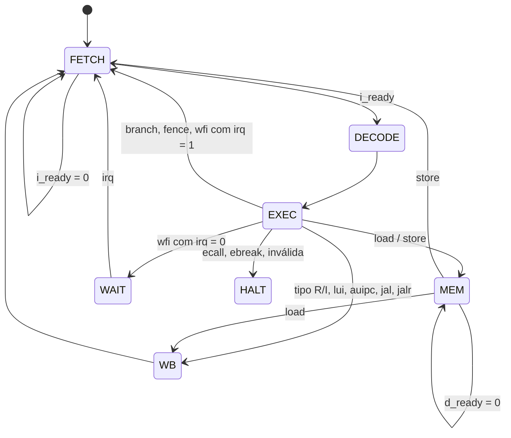

# CPU RV32I multiciclo

CPU RISC-V RV32I em RTL que segue a especificação do [README principal](../../README.md):

- §2: microarquitetura multiciclo;
- §4.1: portas I e D com valid/ready;
- §4.4: `irq` acordando o `wfi`.

## Arquivos

| Arquivo | Conteúdo |
|---|---|
| [`rv32i_cpu.v`](rv32i_cpu.v) | Topo da CPU. Contém os registradores entre estados (PC, IR, A, B, ALUOut, MDR), a lógica das portas e a extração/extensão de byte e half nos loads. |
| [`controller.v`](controller.v) | FSM multiciclo e decodificação. |
| [`alu.v`](alu.v), [`alu_controller.v`](alu_controller.v) | ULA (operações e comparações de desvio) e seu controle. |
| [`imm_gen.v`](imm_gen.v) | Gerador de imediatos: formatos I, S, B, U e J. |
| [`reg_bank.v`](reg_bank.v) | Banco de 32 registradores com x0 fixo em zero. |
| [`imem.v`](imem.v) | Memória de instruções local: 64 KiB em `0x0000_0000`, `$readmemh` e latência de 1 ciclo. |

## Interface

| Sinal | Dir. | Largura | Descrição |
|---|---|---|---|
| `clk`, `rst_n` | in | 1 | Clock e reset assíncrono ativo em 0 |
| `i_valid`, `i_addr` | out | 1, 32 | Busca no PC (alinhado a 4) |
| `i_ready`, `i_rdata` | in | 1, 32 | Instrução pronta |
| `d_valid`, `d_addr` | out | 1, 32 | Load/store no endereço do byte |
| `d_wstrb` | out | 4 | `0000` = leitura; SB `0001 << addr[1:0]`; SH `0011 << addr[1:0]`; SW `1111` |
| `d_wdata` | out | 32 | Dado de escrita já posicionado na lane do byte |
| `d_ready`, `d_rdata` | in | 1, 32 | Transação concluída e palavra lida |
| `irq` | in | 1 | Interrupção (nível); acorda o `wfi` |
| `halt` | out | 1 | Sinal de depuração: 1 depois de `ecall`, `ebreak` ou instrução inválida |

Os `valid` saem direto do estado da FSM. A CPU mantém endereço e dados estáveis até o `ready` e tem no máximo uma requisição por vez. As duas portas nunca ficam ativas ao mesmo tempo.

## FSM



| Estado | O que faz |
|---|---|
| `FETCH` | `i_valid = 1` com `i_addr = PC`; no `i_ready`, guarda a instrução no IR |
| `DECODE` | Lê rs1 e rs2 para A e B |
| `EXEC` | ULA: operação, endereço do load/store ou comparação do desvio. Guarda o resultado em ALUOut. Branch, fence e wfi terminam aqui. |
| `MEM` | `d_valid = 1` com `d_addr = ALUOut`; no `d_ready`, o load guarda a palavra no MDR |
| `WB` | Escreve em rd: ALUOut, load estendido (lb/lh/lbu/lhu/lw), imediato (lui) ou PC+4 (jal/jalr) |
| `WAIT` | `wfi`: portas paradas até `irq = 1`; sai para o FETCH no ciclo seguinte |
| `HALT` | Parada definitiva: o PC fica na instrução que parou |

O PC só é atualizado quando a instrução termina, na transição para `FETCH`. Assim, jal e jalr gravam PC+4 da própria instrução. O destino do jalr é `(rs1 + imm)` com o bit 0 zerado.

### Ciclos por instrução

Com a IMEM de 1 ciclo, o `FETCH` leva 2 ciclos. L é a latência da Porta D: ciclos com `d_valid = 1` antes do `d_ready`.

| Instrução | Ciclos |
|---|---|
| Tipo R/I, lui, auipc, jal, jalr | 5 |
| Branch, fence, wfi (sem espera) | 4 |
| Load | 6 + L |
| Store | 5 + L |

Nos programas de teste, com a Porta D respondendo no mesmo ciclo, o CPI ficou entre 4,7 e 5,1.

### Decisões

- **ecall e ebreak:** não há CSRs nem trap (decisão da §2). Por isso as duas param a CPU no `HALT`. Uma instrução com opcode inválido também para no `HALT`.
- **fence:** não tem efeito, porque não há cache nem buffer de escrita.
- **wfi** (`0x10500073`):
  - com `irq = 1`, segue direto e o evento não se perde;
  - com `irq = 0`, a CPU espera no `WAIT`.
- **Acessos desalinhados:** não geram trap. O endereço vai inteiro em `d_addr`, e o firmware deve usar acessos alinhados.
- **Erros de barramento (§4.1):** são tratados pelo `cpu_axi_adapter`. Para a CPU, a leitura volta 0 e a escrita some.

## Verificação

Testbenches em [`tb/unit_cpu/`](../../tb/unit_cpu/), rodados no Cadence Xcelium:

| Testbench | O que confere |
|---|---|
| `tb_cpu` | Roda cada programa de [`programs/`](../../tb/unit_cpu/programs/) com a IMEM real e um modelo de memória na Porta D. Compara os 32 registradores e o PC final com o simulador de referência (`.regs`). Cada programa roda duas vezes: com latência mínima e com latência aleatória nas portas I (0–3 ciclos extras) e D (0–6 ciclos). Um monitor confere o protocolo: `valid`, endereço e dados estáveis até o `ready`, `i_addr` alinhado e as portas nunca juntas. |
| `tb_cpu_irq` | Roda o fluxo do firmware da §7 ([`13_dma_wfi.s`](../../tb/unit_cpu/programs/13_dma_wfi.s)) com um modelo dos registradores do DMA da §3.2. Confere os valores de ADDR/DIM escritos e o `wfi` dormindo até o `irq`, sem acessos às portas e acordando no ciclo seguinte. Confere também o `wfi` com `irq` já em 1, sem parar, o W1C do STATUS, o polling sem `IRQ_EN` e `d_wstrb`/`d_wdata` do sb e do sh. |
| `tb_imem` | Carga por `$readmemh`, `ready` de 1 ciclo com o dado certo, requisições coladas e reset. |
| `tb_alu`, `tb_alu_controller`, `tb_imm_gen`, `tb_register_file` | Módulos reaproveitados, testados isoladamente. |

Os programas 01 a 10 cobrem as 37 instruções de usuário do RV32I:

- 01 a 05: ULA, shifts, comparações, lui/auipc;
- 06 e 07: load/store de palavra, byte e half;
- 08 e 09: desvios e saltos;
- 10: algoritmos.

Os outros três:

- 11: fence e ebreak;
- 12: ecall;
- 13: o fluxo com o DMA.

Os `.regs` vêm do simulador de referência em Python.

```bash
scripts/run_cpu_tests.sh                     # todos os testes (30 execuções)
scripts/run_cpu_tests.sh tb_cpu_irq          # só um testbench
WAVES=1 scripts/run_cpu_tests.sh tb_cpu_irq  # também grava build/cpu/tb_cpu_irq.shm

# formas de onda no SimVision, com os sinais agrupados (FSM, Porta I, Porta D, ...)
SHM=build/cpu/tb_cpu_irq.shm TOP=tb_cpu_irq simvision -input scripts/simvision_cpu.tcl
```
